# Swipe Ocean

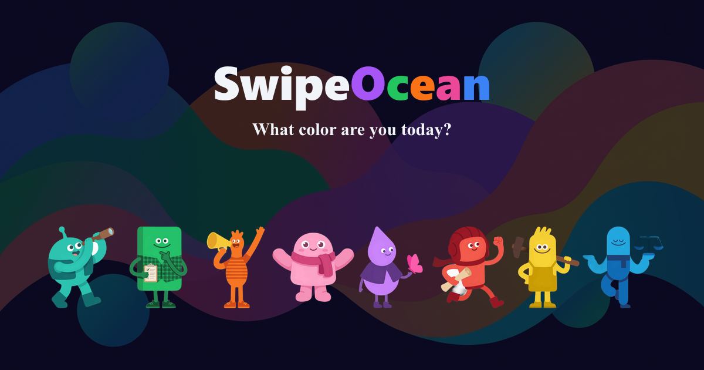

There's an ocean where 8 colors live. All different. None better than the rest.

Just swipe -- left for "not me today," right for "that's so me." In about 10 seconds, the ocean reads your vibe and tells you which color you are right now.

Different mood, different color. That's not a bug -- that's the point. You're not one thing. You never were.

**[Dive in](https://swipeocean.surf)** -- 10 seconds, that's it. | [See how it works](https://swipeocean.surf/about?l=en)

---

## Meet the Crew

<table>
<tr>
<td align="center" width="12%">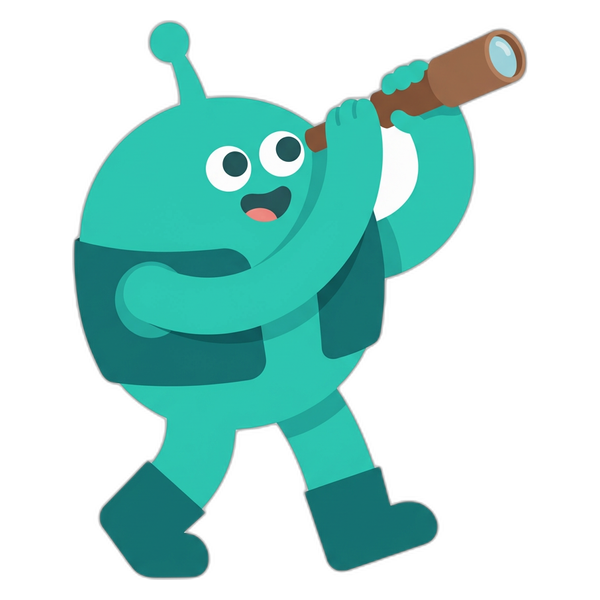 <b>Explorer</b> Curious. Restless. Always chasing the next thing.</td>
<td align="center" width="12%">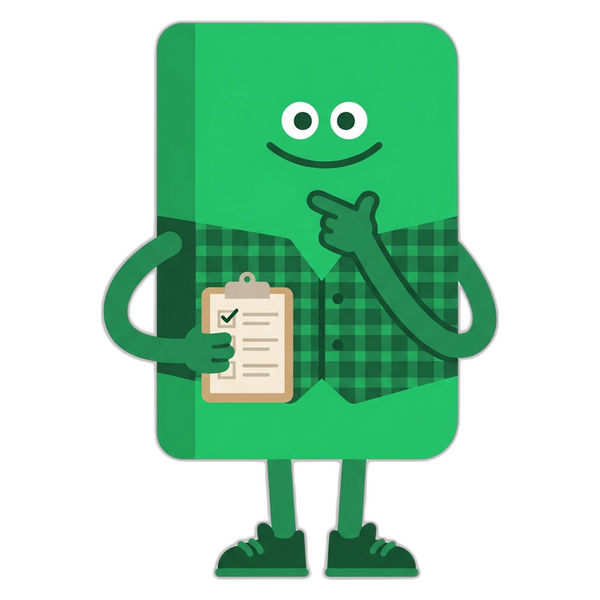 <b>Planner</b> Strategic. Reliable. Has a spreadsheet for everything.</td>
<td align="center" width="12%">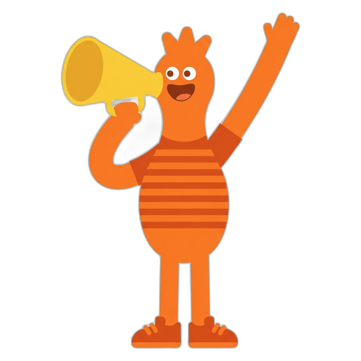 <b>Socialite</b> Energetic. Warm. The life of every room.</td>
<td align="center" width="12%">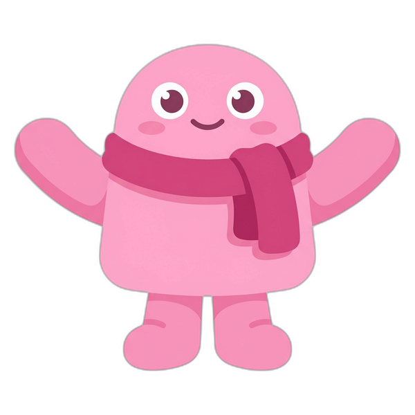 <b>Harmonizer</b> Caring. Steady. The one everyone counts on.</td>
</tr>
<tr>
<td align="center">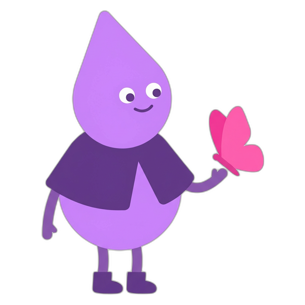 <b>Empath</b> Sensitive. Deep. Feels everything -- and that's a superpower.</td>
<td align="center">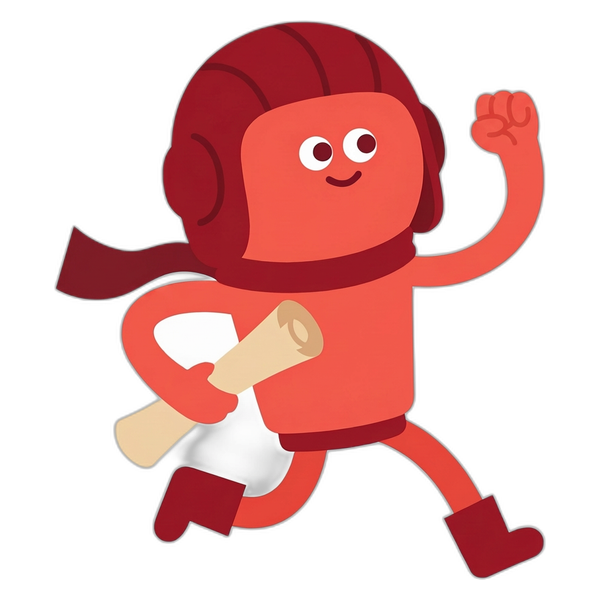 <b>Adventurer</b> Bold. Free. Jumps first, thinks later.</td>
<td align="center">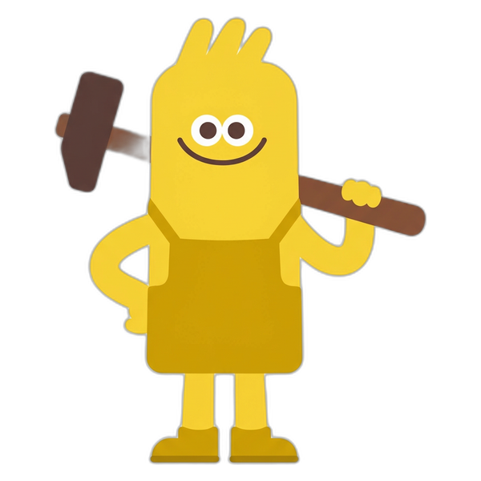 <b>Craftsman</b> Focused. Skilled. Obsessed with getting it right.</td>
<td align="center">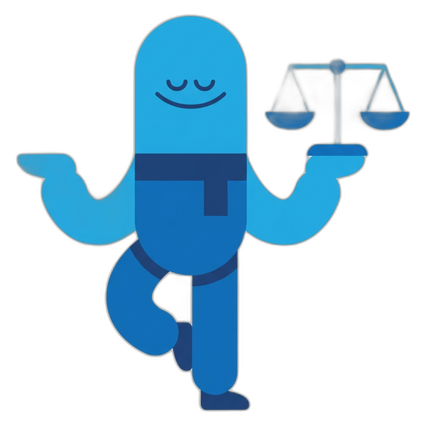 <b>Balancer</b> Adaptable. Calm. Finds the sweet spot in everything.</td>
</tr>
</table>

*Which one are you today? **[There's only one way to find out.](https://swipeocean.surf)***

Here's what a result looks like:

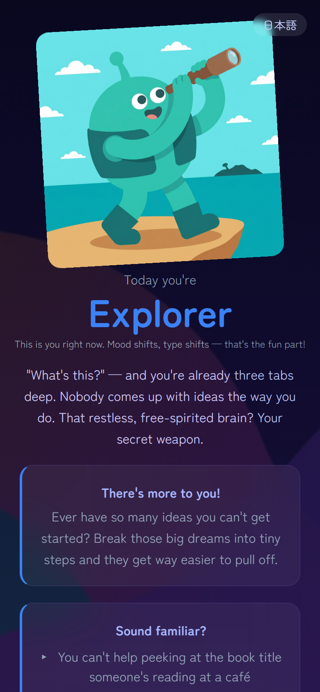

---

## Why I Built This

Personality tests always felt like exams to me. 50 questions, clinical labels, "you scored low on agreeableness." It felt like being graded, not understood.

I wanted something different. Something that says "hey, here's who you are today -- and that's great." No ranking. No good or bad scores. Just a color that's yours right now.

Every type has its strengths. Every color is a good one.

---

## The Science Behind It

Swipe Ocean is built on the **Big Five (OCEAN) model** -- the most widely validated personality framework in psychology. Five traits, decades of peer-reviewed research, used across cultures worldwide.

| Trait | What it means |
|-------|---------------|
| **O**penness | Curiosity, imagination, openness to new experiences |
| **C**onscientiousness | Organization, discipline, goal-oriented behavior |
| **E**xtraversion | Energy from social interaction, assertiveness |
| **A**greeableness | Cooperation, empathy, trust in others |
| **N**euroticism (Sensitivity) | Emotional responsiveness, depth of feeling |

Unlike pop-psychology quizzes (looking at you, "Which bread are you?"), the Big Five has real scientific backing. Swipe Ocean uses this as the foundation, then wraps it in a visual, swipe-based interface that actually feels fun.

Your swipe choices map to these 5 traits. The combination determines which of the 8 types fits you best right now -- not forever, just today.

Scoring logic is fully transparent and open source: [`src/data/personalityTypes.ts`](src/data/personalityTypes.ts)

---

## How It Works

<table>
<tr>
<td align="center" width="50%">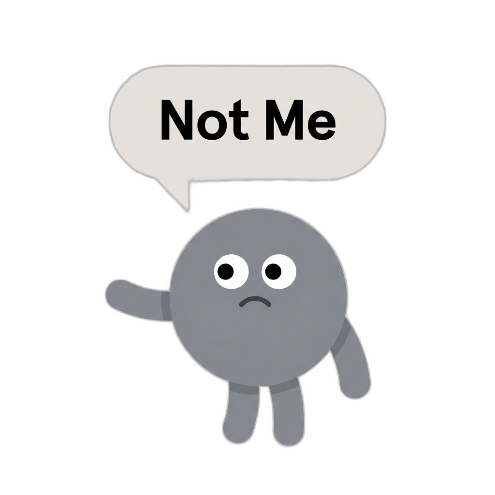 <b>← Swipe Left</b> "Not me today"</td>
<td align="center" width="50%">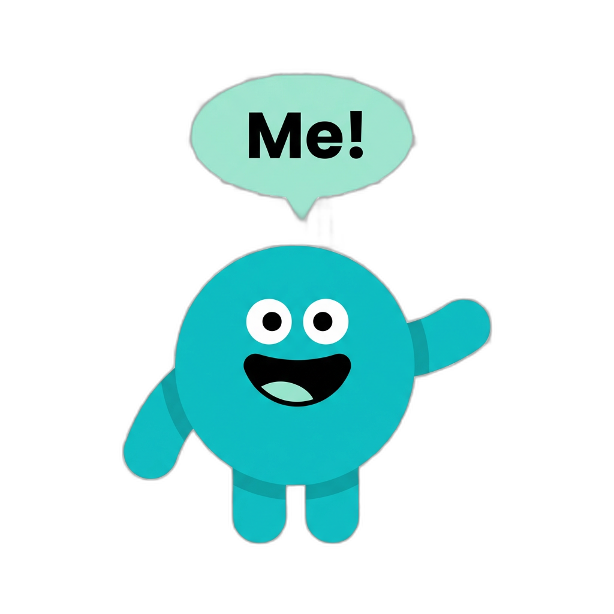 <b>Swipe Right →</b> "That's me!"</td>
</tr>
</table>

1. **Swipe** -- flip through a deck of images
2. **Score** -- your choices map to 5 Big Five traits (all client-side)
3. **Match** -- trait combination → one of 8 types

Plus: radar chart of your 5 traits, OGP cards for social sharing, full bilingual support (EN/JA).

## Tech Stack

Next.js 16 (App Router) + React 19 + TypeScript (strict) + Tailwind CSS 3, deployed on Cloudflare Workers via @opennextjs/cloudflare.

## Contributing

Want to fix a translation, improve type descriptions, or report a bug? See [CONTRIBUTING.md](CONTRIBUTING.md).

## License

[MIT](LICENSE)

---

## Japanese / 日本語

8つの色が暮らす海。どの色もちがって、どれもいい。

スワイプするだけ。海がキミの「今」を読みとって、約10秒で今日の色を教えてくれる。

気分が変われば、また違う色。それでいい。キミはひとつじゃない。

ベースは Big Five（OCEAN）-- 心理学でいちばん検証されてるやつ。でも堅くない。スワイプするだけ、遊び感覚。

- レーダーチャートで5特性のバランスを可視化
- OGP画像付きでSNSシェア

**[やってみる](https://swipeocean.surf?l=ja)** -- 約10秒。 | [くわしく見る](https://swipeocean.surf/about?l=ja)

---

Built by [@shumatsumonobu](https://x.com/shumatsumonobu)
