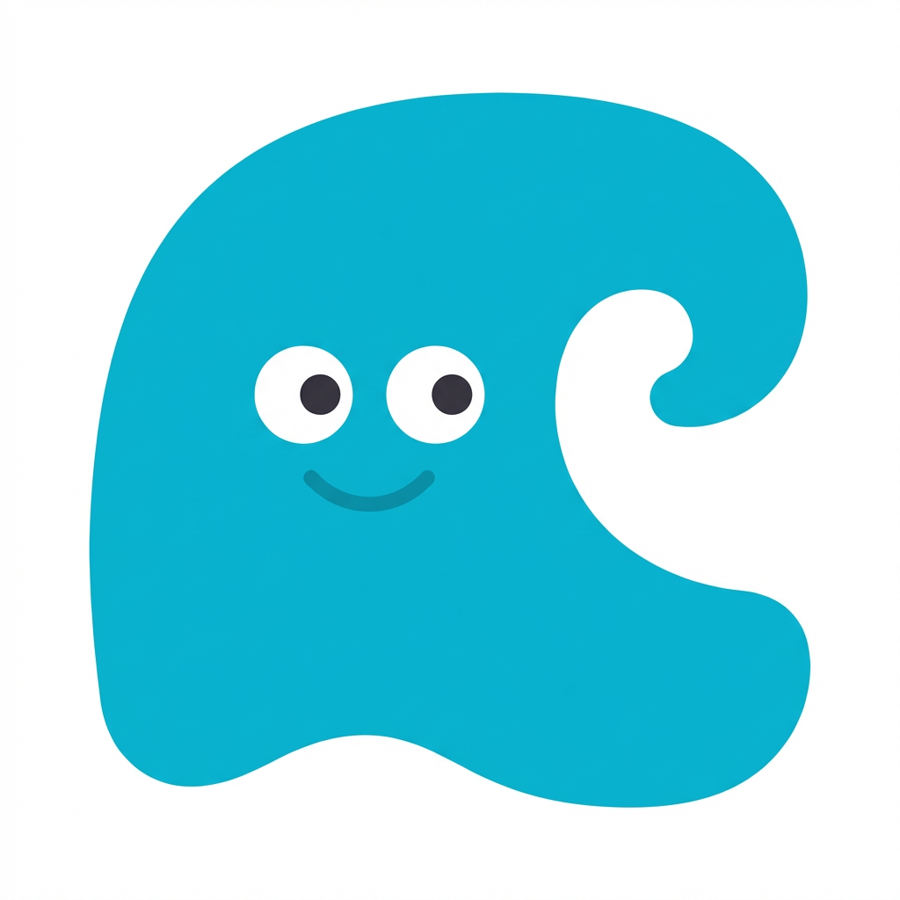

# アプリアイコン（favicon / PWA）

> ブラウザタブ、ホーム画面追加時に表示されるアイコン。Swipe Ocean の「顔」。

## デザイン方針

- **Headspaceスタイル:** 8体のキャラクター・特性アイコンと同じ世界の住人。フラットデザイン、影なし・光沢なし・グラデーションなし
- **波モチーフ:** アプリ名「Swipe Ocean」にちなんだ海の象徴。ぽってり丸い波に顔をつける
- **キャラクター化:** 特性アイコンと同じ手法 — モチーフに**顔をつける**。体・手足はなし。モチーフの形がそのまま「体」
- **アプリアイコンとして成立:** 白い正方形の背景（角丸はOS側でマスク処理される）。ホーム画面やタブに並んだ時に映える
- **小サイズ対応:** favicon（32×32）でも認識できるシンプルさ

## アイコン仕様

| 項目 | 値 |
|------|-----|
| モチーフ | 波キャラクター（Ocean の象徴） |
| カラー | シアン `#06B6D4`（アプリのプライマリカラー）。ベタ塗り1色 |
| 背景 | 白 `#FFFFFF` の正方形（角丸はOSがマスク処理するので画像は正方形のまま） |
| 形状 | **1つの大きなうねり。** 丸くふくらんだ波頭が右上にくるんとカール。底辺はゆるやかなカーブ。全体のシルエットは正方形に収まる丸い塊。リアルな波ではなくHeadspace的な太くぷっくりした形 |
| 顔パーツ | 白い丸い目（白い強膜＋黒い瞳）＋シンプルな弧の口。8体のキャラクター・特性アイコンと統一 |
| 表情 | にっこり微笑み（アプリの第一印象＝やさしい・楽しそう） |
| 顔の位置 | 波の中心〜やや上（波のふくらみの中に顔） |
| 顔のサイズ | モチーフ全体の25〜30%程度。主役はあくまで波の形 |
| 顔の色 | 目の白 = `#FFFFFF`、瞳 = `#000000`、口 = シアンの濃い色（キャラクターと同じ手法） |
| **絶対NG** | 影、光沢、グラデーション、リアルなディテール、テキスト・文字、手足、複数キャラ、尖った角、波しぶき・泡の装飾 |

## 共通プロンプト要件

上記仕様テーブルに従う。プロンプト用キーワード:

- `Headspace-style flat illustration, same world as the character icons and trait icons`
- `solid white square background, cyan #06B6D4 flat fill`
- `rounded edges, motif fills most of the canvas`
- `white sclera eyes with black pupils, gentle smile`
- `1:1 square, 1024×1024`
- `No shadows, no gloss, no gradients, no limbs, no text, no sharp corners, no spray/bubbles`

## 生成戦略

1. 特性アイコン（`scripts/trait-icons/agreeableness-02.png`）を `--reference` で渡して世界観を揃える
2. 試行→レビュー→プロンプト調整→再生成のサイクル
3. 確定後、リサイズして `src/app/` に配置

## レビュー観点

すべて◎を満たすまで再生成する。

| 観点 | 基準 | NG例 |
|------|------|------|
| Headspace世界観 | 8体のキャラ・特性アイコンと**同じ世界の住人**に見える | グラデーション風、emoji風、リアル、企業ロゴ的 |
| かわいさ | パッと見て「かわいい！使ってみたい！」 | 無機質、硬い、怖い |
| 小サイズ視認性 | 32×32 に縮小しても波＋顔が認識できる | 細部がつぶれる、何のアプリかわからない |
| アプリアイコンとしての完成度 | 他のアプリと並んでも見劣りしない。正方形の中にバランスよく収まる | 余白が偏っている、モチーフが小さすぎ/大きすぎ |
| Swipe Oceanらしさ | 「海」「水」を感じる。アプリ名と合う | 海要素ゼロ、何のアプリか伝わらない |

## ファイル構成

- **プロンプト・生成設定:** `scripts/prompts/app-icon/prompts.json`（生成時に自動作成）
- **生成スクリプト:** [`scripts/gen-app-icon.mjs`](../../scripts/gen-app-icon.mjs)
- **試行ファイル:** `scripts/app-icons/`（`app-icon-{NN}.png` のフラット構造）
- **格納先:** `src/app/`（favicon.ico: 32×32、icon.png: 192×192、apple-icon.png: 180×180）
- **使用箇所:** Next.js App Router が `src/app/` 内のファイル名規約で自動認識（コード参照なし）

512×512以上で生成し、各サイズにリサイズして配置。

```bash
# 新規生成（プロンプト指定 → prompts.json に自動記録）
node scripts/gen-app-icon.mjs --prompt "..." --temp 0.5

# 参考画像を渡して世界観を揃える
node scripts/gen-app-icon.mjs --prompt "..." --reference scripts/trait-icons/agreeableness-02.png

# 再生成（JSON から読み込み）
node scripts/gen-app-icon.mjs

# 確定後、リサイズして src/app/ に配置（手動 or sharp スクリプト）
```

## ギャラリー

### 採用

| |
|:--:|
|  |
| app-icon-01 ⭐ |

