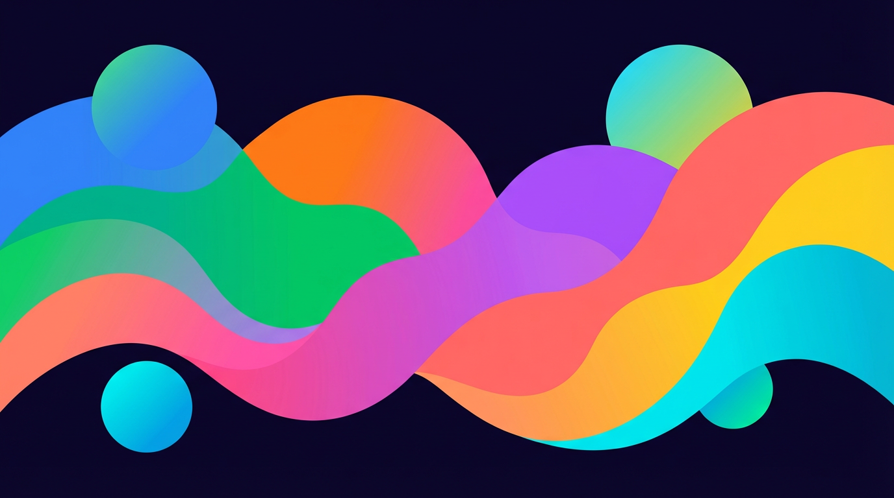

# 背景イラスト

> 全ページ共通の背景イラスト。`hero-top.png` 1枚を全ページで opacity を変えて使用（トップ/LP: 0.18、スワイプ/結果: 0.10）。

## デザイン方針

### テイスト統一の原則

キャラクターは**Headspace風フラットデザイン**（幾何学的・丸い・ベクター風クリーン塗り）。背景もこのテイストと調和させる。

**フラット・スムーズグラデーション・エッジくっきり**で統一（水彩にじみ・線画タイルは Headspace のフラットスタイルと合わないため NG）。

### ダークテーマ対応

UIはダークバイオレットテーマ（`#0a0a1f → #16103a → #1e1650`）。背景画像もこれに合わせる。

**暗い画像が必要な理由:**

- 使用箇所: `opacity: 0.10〜0.18` で暗い背景の上に重ねる
- 明るい画像 × 低opacity → 白っぽいベールがかかる（テーマと不調和）
- 暗い画像 × 低opacity → 鮮やかな色が暗闇に淡く浮かび上がる

### ヒーロー背景イラスト

**情緒的な役割:** 「ワクワク！やってみよう！」— 8色が混ざり合うにぎやかさ。全タイプの色が同居 = 「どんな色もいい」のビジュアル表現。

- **フラットブロブ:** キャラと同じ幾何学的・なめらかなスタイル。水彩にじみNG
- **8色の融合:** 8タイプの固有カラーが暗い背景の上で鮮やかに映えるブロブ構成
- **鮮やかに描く:** CSS `opacity-[0.18]` で透かすため、元が淡いと消える。**ダーク背景 × 鮮やかな色 = 自然にグロー感が出る**（glowを明示的に指示しない。写実的ライティングに引っ張られるため）
- **温かい夜の海:** 怖くない暗さ、安心できる雰囲気。冷たさ・SF感を避ける

### スワイプ背景

**情緒的な役割:** 「集中・没入」— 静かで落ち着いた深海。カードに意識を向ける空間。気にならないけど、ふと気づくと心地よい。

- **フラットブロブ:** キャラと同じ幾何学的・なめらかなスタイル。水彩にじみNG
- **1枚絵:** タイル繰り返しではなく `background-size: cover` で配置
- **シアン〜ブルー系 + バイオレット差し色:** スワイプUIと統一。差し色にバイオレット `#a855f7` + インディゴ `#818cf8`
- **CSS `opacity: 0.10`:** カードの邪魔をしない控えめな存在感

## 画像仕様

### 1. ヒーロー背景イラスト

| 項目 | 値 |
|------|-----|
| ファイル名 | `hero-top.png` |
| 生成サイズ | 16:9（~1376 × 768 px）— Gemini API `imageSize: "1K"` |
| 最終サイズ | 1200 × 675 px — `sharp.resize(1200, 675)` 単純縮小 |
| フォーマット | PNG |
| 使用箇所 | トップページ、`position: absolute` + `opacity-[0.18]` で背景に敷く |
| 配置先 | `public/images/bg/hero-top.png` |

## キャラクター8色（ヒーロー背景用）

ヒーロー背景プロンプトに含めるカラーパレット。`personalityTypes.ts` の `color` 値。
スワイプ背景はシアン+ブルー+差し色のみ（プロンプト要件参照）。

| タイプ | カラー | 色名 |
|--------|--------|------|
| explorer | `#3b82f6` | 青 |
| planner | `#22c55e` | 緑 |
| socialite | `#f97316` | オレンジ |
| harmonizer | `#ec4899` | ピンク |
| empath | `#a855f7` | 紫 |
| adventurer | `#f87171` | 赤 |
| craftsman | `#facc15` | 黄 |
| balancer | `#06b6d4` | シアン |

## 共通プロンプト要件

### ヒーロー背景

- 16:9 横長、ダークネイビー `#0a0a1f` ベース
- 8色のブロブが夜空と海が溶け合う空間で横に流れる抽象イラスト
- 鮮やかなフラット色（opacity 0.18 で透かすため元は濃く）
- `flat, smooth gradients, clean vector-like blobs, smooth but crisp edges`
- `No characters, no people, no text, no objects, no bright backgrounds, no shadows, no watercolor, no paint strokes`

### スワイプ背景

- 1:1、ダークネイビー `#0a0a1f` ベース
- シアン＋ブルーメイン、差し色にバイオレット＋インディゴ
- `flat, smooth gradients, clean vector-like blobs, smooth but crisp edges`
- `No characters, no people, no text, no objects, no bright backgrounds, no watercolor, no paint strokes`

## プロンプト

本番プロンプトテキストは `scripts/prompts/bg-hero/prompts.json` に記録。

## 生成戦略

1. **ヒーロー背景**から開始 — 8色を扱うため難易度が高い。先にこちらを確定
2. 3〜5枚生成し、`npm run dev` でトップページに表示して実際の opacity で確認
3. ◎になったら**スワイプ背景**に進む。ヒーローと同じ「深海の夜」の世界観を揃える
4. 同様に 3〜5枚生成、`npm run dev` でスワイプ画面で確認
5. 両方確定したら `deploy-assets.mjs bg` でリサイズ+配置

## レビュー観点

すべて◎を満たすまで再生成する。

**確認手順:** `npm run dev` → 該当ページを開き、実際の opacity（0.10〜0.18）での見え方で判定。元画像単体ではなく重ね表示で評価する。

**opacity の見え方基準:** うっすら色味が感じられる程度が理想。はっきり形がわかるほどは不要。「なんとなく奥に色がある」くらい。opacity が低すぎて完全に見えない場合は値を上げて調整。

### ヒーロー背景

| 観点 | 基準 | NG例 |
|------|------|------|
| 温かい神秘感 | 怖くない暗さ、安心できる夜の海。「ほっとする」+「わくわく」 | 冷たい、SF的、不気味、無機質 |
| 色の鮮やかさ | 暗い背景に鮮やかなフラット色が映えている。`opacity-[0.18]` で透かしても色が感じられる | 色が暗すぎて消える、または明るすぎてテーマと合わない |
| 8色の融合 | 8色が自然に溶け合い、どの色も悪目立ちしない。「どんな色もいい」 | 1色だけ浮いている、境界がくっきりしすぎ |
| 夜空×海 | 夜空と海が溶け合う抽象表現。Swipe Oceanの世界 | リアルな海の写真風、具象的すぎ |
| ダーク背景との相性 | `#0a0a1f` の上に `opacity-[0.18]` で置いて色のグローが淡く浮かぶ | 白っぽく見える、背景と溶け込みすぎて見えない |

### スワイプ背景

| 観点 | 基準 | NG例 |
|------|------|------|
| フラットスタイル | キャラと同じ幾何学的・なめらかな塗り | 水彩にじみ、筆ストローク、線画 |
| 没入感 | 「気にならないけど、ふと気づくと心地よい」レベルの存在感 | 密度が高すぎ、色が強すぎ、主張しすぎ |
| 色の鮮やかさ | 元画像は十分鮮やか（opacityで薄まるため） | 元が淡すぎてopacity後に消える |
| 世界観統一 | ヒーロー背景と同じ「夜の海」+ キャラのスタイルに近い | テイスト分裂 |

## ファイル構成

- **生成スクリプト:** [`scripts/gen-bg-hero.mjs`](../../scripts/gen-bg-hero.mjs)
- **プロンプト・生成設定:** `scripts/prompts/bg-hero/prompts.json`
- **試行ファイル:** `scripts/bg-hero/`（連番フラット構造）
- **リサイズ+配置:** [`scripts/deploy-assets.mjs`](../../scripts/deploy-assets.mjs) に `bg` カテゴリ
- **格納先:** `public/images/bg/hero-top.png`
- **使用箇所:** 全ページ共通（トップ/LP: opacity 0.18、スワイプ/結果: opacity 0.10）

```bash
# ヒーロー背景生成（--prompt で本番プロンプトを渡す。上記「プロンプト」セクションからコピペ）
node scripts/gen-bg-hero.mjs --prompt "Abstract illustration with flowing blobs..."

# 確定後：リサイズ + 本番ディレクトリに配置
node scripts/deploy-assets.mjs bg
```

## ギャラリー

### ヒーロー背景

| |
|:--:|
|  |
| 15 ⭐ |
