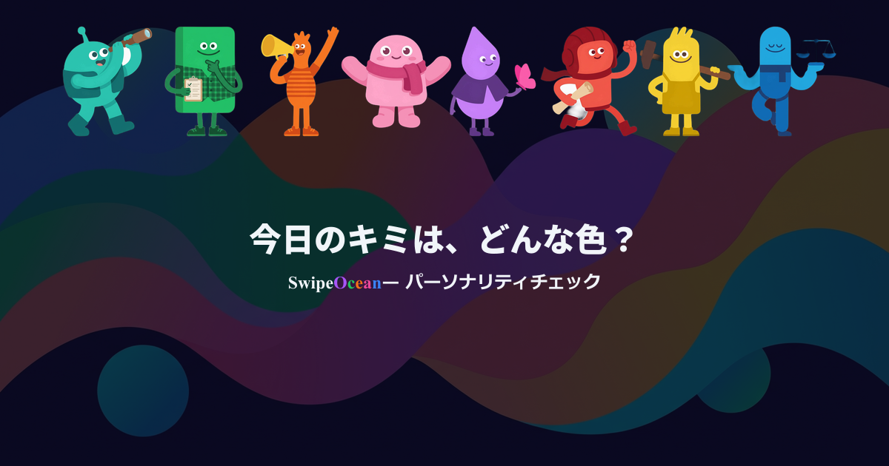

# LP OGP画像（日英2枚）

> `/about` ページをSNSシェアした時に表示される専用OGP画像。「やってみたい！」の興味を引く一枚。

## デザイン方針

- **コンセプト:** 「8色の世界に飛び込みたくなる一枚」
- **トップOGPとの差別化:** 構図を上下逆転。トップ=「ロゴ上 + キャラ下」、LP=「キャラ上 + コピー下」
- **日英2枚体制:** テキストのみ差分。画像構成は共通
- **Headspace世界観:** キャラクターと同じフラットデザイン。影なし・光沢なし
- **ダークテーマ:** アプリ本体と一貫した夜空ベース

## 画像仕様

| 項目 | 値 |
|------|-----|
| サイズ | 1200 × 630 px |
| フォーマット | PNG |
| 枚数 | 2枚（日本語・英語） |
| 背景 | ダークネイビー `#0a0a1f`（+ ヒーロー背景薄く敷き任意） |
| キャラクター | 8体全員（既存アセット `public/images/characters/type_{type}.png`） |
| テキスト | キャッチコピー（白 `#f1f5f9`）+ サービス名（Ocean 5色） |
| フォント | Zen Maru Gothic Bold |

## 構図案

トップOGPと上下逆の構図で差別化。キャラ8体が上部、テキストが下部。

```
┌───────────────────────────────────────────┐
│                                           │
│    🟢 🟠 🟡 🟣 🔵 🩷 🔴 🩵               │
│   (8体キャラ横一列・上部配置)              │
│                                           │
│      今日のキミ、どんな色？              │
│  Swipe Ocean — パーソナリティチェック       │
│                                           │
└───────────────────────────────────────────┘
```

- キャラ: 上部に8体横一列、160px、stride 130px
- テキスト: 下部、中央揃え
- キャラ並び順（左から）: explorer → planner → socialite → harmonizer → empath → adventurer → craftsman → balancer（トップページ・LP と同じ）

## トップOGPとの差別化

| | トップOGP（`top-ja.png` / `top-en.png`） | LP OGP（`about-*.png`） |
|---|---|---|
| 目的 | 「これ何？」の認知 | 「やってみたい！」の興味 |
| キャラ | **下部**に横一列 | **上部**に横一列 |
| テキスト | **上部**（ロゴ大） | **下部**（キャッチコピー大） |
| コピー | 「Swipe Ocean」+ キャッチコピー | キャッチコピー + 「Swipe Ocean — サービス説明」 |
| 使用箇所 | `/`（トップ） | `/about`（LP） |

## 日英テキスト差分

| ファイル | 1行目（キャッチコピー） | 2行目（サービス説明） |
|---------|----------------------|---------------------|
| `about-ja.png` | 今日のキミ、どんな色？ | Swipe Ocean — パーソナリティチェック |
| `about-en.png` | What color are you today? | Swipe Ocean — Personality Check |

- 1行目: LP の heroTitle と同じ
- 2行目: サービス名（Ocean 5色）+ 端的な説明

## 確定 config

| 項目 | 値 |
|------|-----|
| charSize | 160px |
| charStride | 130px |
| charY | 30px |
| textSvgTop | 280px |
| キャッチコピー | 44px bold |
| サービス説明 | 24px bold |
| テキスト色 | 白 `#f1f5f9`（Ocean部分は5色） |

## 作成方法

`scripts/gen-top-ogp.mjs` をベースに `scripts/gen-lp-ogp.mjs` を新規作成。構成はほぼ同じ（commander CLI + sharp 合成 + フォント base64 埋め込み）。

### 合成パイプライン

```
ダークネイビー背景 (#0a0a1f, 1200×630)
  → hero-top.png を opacity 20% で overlay（--no-bg で省略可）
  → キャラ8体を 160px にリサイズ → 横一列に等間隔配置（y=30、上部）
  → テキストSVG composite（下部、y=280）
    - キャッチコピー 44px bold
    - "Swipe Ocean"（Ocean 5色）+ "— サービス説明" 24px
  → PNG出力
```

## レビュー観点

すべて◎を満たすまで修正する。

| 観点 | 基準 | NG例 |
|------|------|------|
| 「やってみたい！」感 | 見て「面白そう」「やってみたい」と感じる | 企業バナー的、説明的すぎる、堅い |
| トップOGPとの差別化 | トップOGPと並べて構図が逆転していると分かる | トップとほぼ同じに見える |
| 8体の視認性 | 8体全員がはっきり見える。重なりで埋もれない | キャラが小さすぎ、背景に溶け込む |
| テキスト可読性 | キャッチコピー・サービス名が読みやすい | 背景と被って読めない、フォントが小さい |
| SNSサムネイル耐性 | 小さいサムネイルでもキャラとコピーが識別できる | 大画面でしか判別できない |

## ファイル構成

- **設計書:** `docs/design/lp-ogp.md`（本ファイル）
- **生成スクリプト:** [`scripts/gen-lp-ogp.mjs`](../../scripts/gen-lp-ogp.mjs)（`gen-top-ogp.mjs` ベース）
- **プロンプト・生成設定:** `scripts/prompts/lp-ogp/prompts.json`
- **試行ファイル:** `scripts/ogp/about/`（`about-{lang}-{NN}.png` のフラット構造）
- **格納先:** `public/images/ogp/about-ja.png`, `public/images/ogp/about-en.png`
- **使用箇所:** `src/app/about/page.tsx`（`generateMetadata`）

```bash
# 試行生成（scripts/ogp/about/about-{lang}-NN.png に連番出力）
node scripts/gen-lp-ogp.mjs --lang ja
node scripts/gen-lp-ogp.mjs --lang en

# config カスタマイズ
node scripts/gen-lp-ogp.mjs --lang ja --char-size 160 --char-stride 130 --char-y 30 --text-y 280

# ヒーロー背景なし
node scripts/gen-lp-ogp.mjs --lang ja --no-bg

# 確定版を本番配置
node scripts/gen-lp-ogp.mjs --lang ja --char-size 160 --char-stride 130 --char-y 30 --text-y 280 --out public/images/ogp/about-ja.png --force
node scripts/gen-lp-ogp.mjs --lang en --char-size 160 --char-stride 130 --char-y 30 --text-y 280 --out public/images/ogp/about-en.png --force
```

## metadata 設定

`src/app/about/page.tsx` で `generateMetadata` を使用。`?l=` パラメータで OGP画像を切り替え:

- `swipeocean.surf/about?l=en` → 英語OGP
- `swipeocean.surf/about?l=ja` → 日本語OGP
- `swipeocean.surf/about`（パラメータなし）→ デフォルト英語OGP

## ギャラリー

### 採用

| 日本語 | 英語 |
|:--:|:--:|
|  |  |
| ⭐about-ja-06 | ⭐about-en-03 |

