# OGP画像（8枚）

> SNSシェア時に表示されるタイプ別OGP画像。1200×630 PNG。

## デザイン方針

- **背景シーン全面:** 背景シーン（キャラ入り）を横長で生成し、画面いっぱいに敷く
- **下部テキスト帯:** タイプカラーの半透明帯を下部に重ね、白文字でタイプ名（日英）+ Swipe Ocean を表示
- **Headspace世界観維持:** 正方形版の背景シーンを `--reference` で渡し、同じ構図・キャラ・色味を横長で再生成

**制約:** Cloudflare Workers では `next/og`（ImageResponse）の `resvg-wasm` が動作しないため、ローカルで生成した静的画像を使用。

## 画像仕様

| 項目 | 値 |
|------|-----|
| サイズ | 1200 × 630 px |
| フォーマット | PNG |
| 枚数 | 8枚（タイプ別） |
| 背景 | 横長背景シーン（キャラ入り、Gemini生成） |
| テキスト帯 | 下部にタイプカラー半透明帯（高さ約120px、透過50%） |
| テキスト | 白文字。タイプ名（日本語）大 + タイプ名（英語）小 + 「Swipe Ocean」 |
| フォント | Zen Maru Gothic Bold |

## 共通プロンプト要件

正方形版を `--reference` で渡して構図を揃える。プロンプト用キーワード:

- `Headspace-style flat illustration, same character and scene as the reference image`
- 横長 16:9（1200×630 相当）、キャラを参考画像と同じデザイン・色・ポーズで配置
- 横長構図でシーンを左右に拡張（余白で埋めない）
- `flat vector style, no shadows, no gradients, no realistic textures, no text, no character design changes`

## 生成戦略

1. `gen-ogp.mjs` で `--reference` に背景シーンを渡し、横長背景シーンを生成
2. 1タイプずつ生成 → レビュー → 必要なら再生成
3. 8タイプ分の横長背景シーンが確定したら、同スクリプトのテキスト帯合成モードで仕上げる

## レビュー観点

すべて◎を満たすまで再生成する。

| 観点 | 基準 | NG例 |
|------|------|------|
| 正方形版との一致 | キャラのデザイン・色・表情が正方形版と同じ | キャラが変わってる、色が違う、ポーズが違う |
| 横長構図の自然さ | 左右に世界が自然に広がっている。余白を埋めるために変な要素が追加されていない | 左右が単色で埋められてる、不自然なオブジェクト追加 |
| SNS映え | タイムラインで目を引く。「タップして見たい」と思える | 暗い、地味、何のアプリかわからない |
| テキスト帯との相性 | 下部にテキスト帯を重ねても重要な部分が隠れない | キャラの顔が下部にあって帯で隠れる |

## ファイル構成

- **生成スクリプト:** [`scripts/gen-ogp.mjs`](../../scripts/gen-ogp.mjs)（横長背景生成＋テキスト帯合成の2機能）
- **プロンプト・生成設定:** `scripts/prompts/ogp/prompts.json`（生成時に自動作成）
- **試行ファイル:** `scripts/ogp/`（`{type}-{NN}.png` のフラット構造）
- **格納先:** `public/images/ogp/`
- **使用箇所:** `src/app/result/[type]/page.tsx`（`generateMetadata` で `images: ["/images/ogp/${type}-${lang}.png"]`）

```bash
# 横長背景シーン生成（タイプごとに --reference で正方形版を渡す）
node scripts/gen-ogp.mjs explorer --prompt "..." --reference scripts/characters/explorer-bg-04.png

# 再生成（JSON から読み込み）
node scripts/gen-ogp.mjs explorer

# テキスト帯合成（確定した横長背景シーンから最終OGP画像を生成）
node scripts/gen-ogp.mjs --compose
```

## テキスト帯合成（`--compose`）

確定した横長背景シーンにテキスト帯を合成し、最終OGP画像を生成する。

### 合成パイプライン

```
確定横長シーン (1376×768)
  → sharp.resize(1200, 630, { fit: "cover", position: "center" })
  → テキスト帯SVGを composite（bottom gravity）
  → PNG出力 → public/images/ogp/{type}-{lang}.png
```

### テキスト帯デザイン

| 項目 | 値 |
|------|-----|
| 帯サイズ | 1200 × 120 px |
| 帯位置 | 画像下端（y = 510〜630） |
| 帯色 | タイプカラー、50%透過（alpha 0.5） |
| テキスト色 | 白（#FFFFFF） |
| フォント | Zen Maru Gothic Bold（`scripts/fonts/ZenMaruGothic-Bold.ttf`） |

テキストレイアウト（帯内）:

```
|  探求者                              Swipe Ocean  |
|  Explorer                                         |
```

- タイプ名（日本語）: 40px bold, 左から40px, 帯上部から30px
- タイプ名（英語）: 22px bold, 左から40px, 日本語名の下8px
- 「Swipe Ocean」: 28px bold, 右から40px, 垂直中央

### 確定ファイルマッピング

| タイプ | 入力（scripts/ogp/） | カラー | nameJa | nameEn |
|--------|------------------------|--------|--------|--------|
| explorer | explorer-01.png | #2DD4BF | 探求者 | Explorer |
| planner | planner-01.png | #22C55E | 計画者 | Planner |
| socialite | socialite-01.png | #F97316 | 社交家 | Socialite |
| harmonizer | harmonizer-02.png | #F9A8D4 | 協調者 | Harmonizer |
| empath | empath-01.png | #C084FC | 感受者 | Empath |
| adventurer | adventurer-01.png | #F87171 | 冒険家 | Adventurer |
| craftsman | craftsman-01.png | #FACC15 | 職人 | Craftsman |
| balancer | balancer-01.png | #0EA5E9 | バランサー | Balancer |

### フォント埋め込み

sharp の SVG composite はシステムフォントを参照する。Zen Maru Gothic がOSにインストールされていない環境でも動作するよう、SVG内に `@font-face` で TTF を base64 埋め込みする。

### CLI

```bash
# 全8タイプ一括合成
node scripts/gen-ogp.mjs --compose

# 特定タイプのみ
node scripts/gen-ogp.mjs --compose explorer
```

出力先: `public/images/ogp/{type}-{lang}.png`（既存ファイルは上書き）

## 参考画像 → 横長 比較

| | 参考画像（正方形） | 横長（OGP） |
|:--|:--:|:--:|
| **explorer** |  | 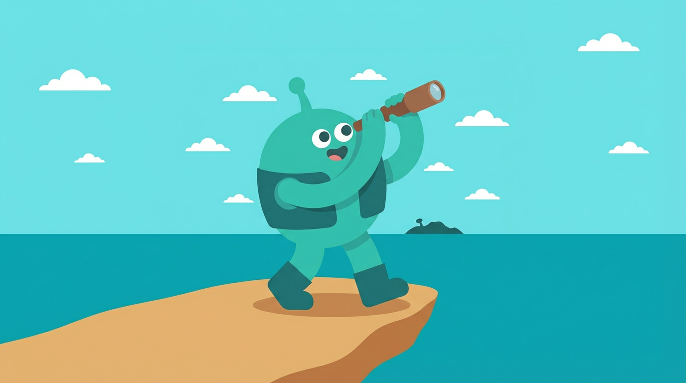 explorer-01⭐ |
| **planner** | 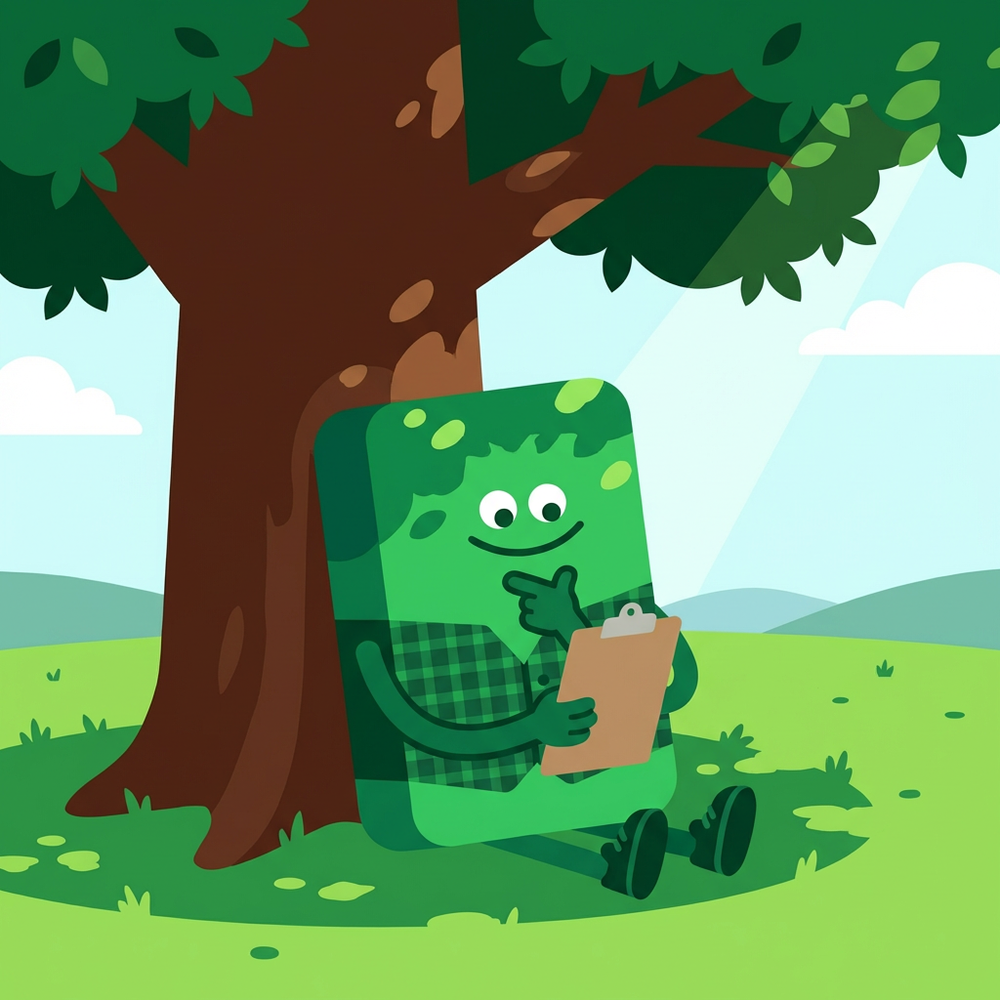 | 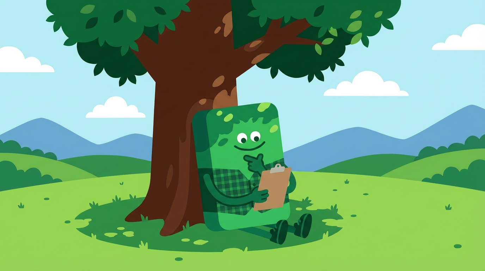 planner-01⭐ |
| **socialite** | 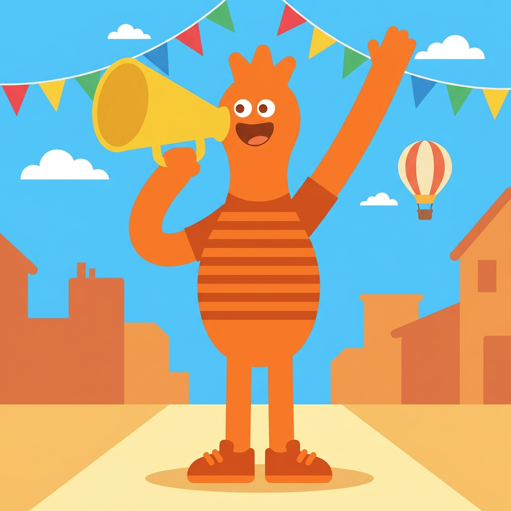 | 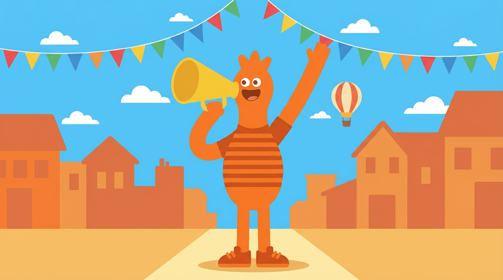 socialite-01⭐ |
| **harmonizer** | 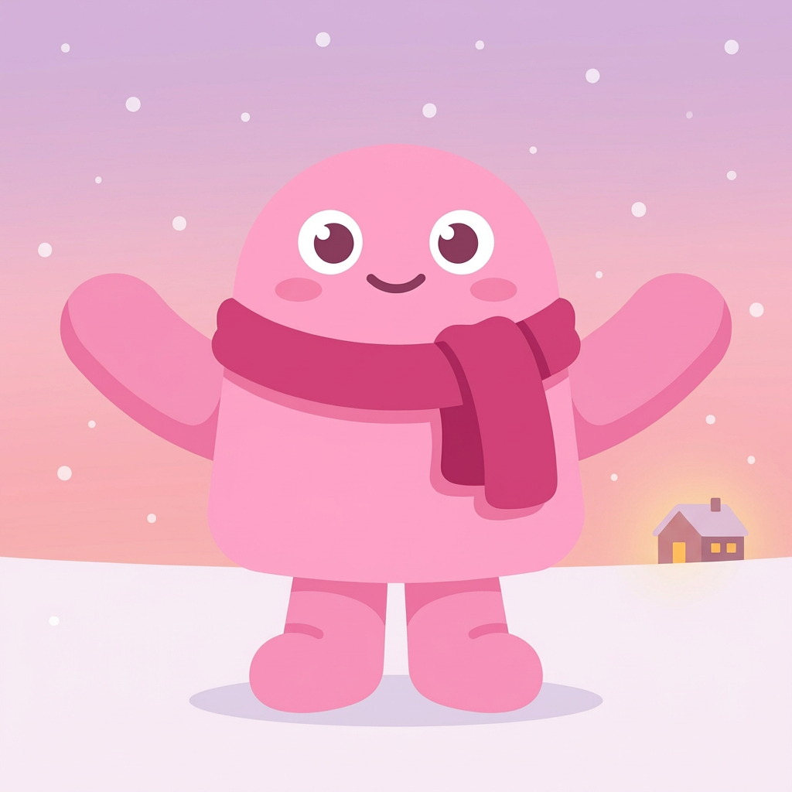 | 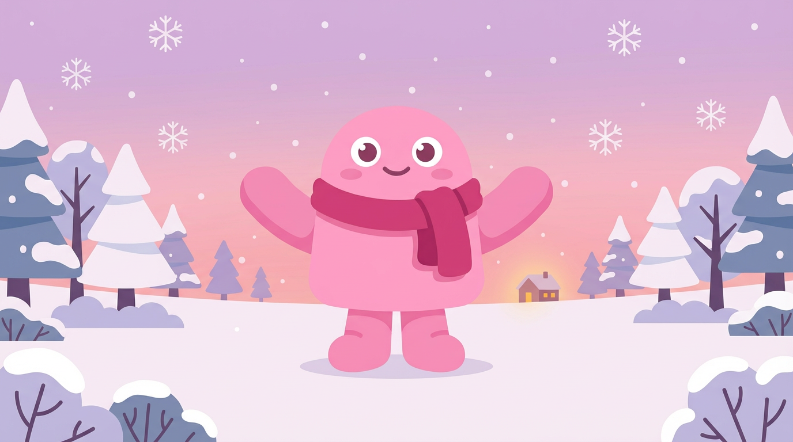 harmonizer-02⭐ |
| **empath** | 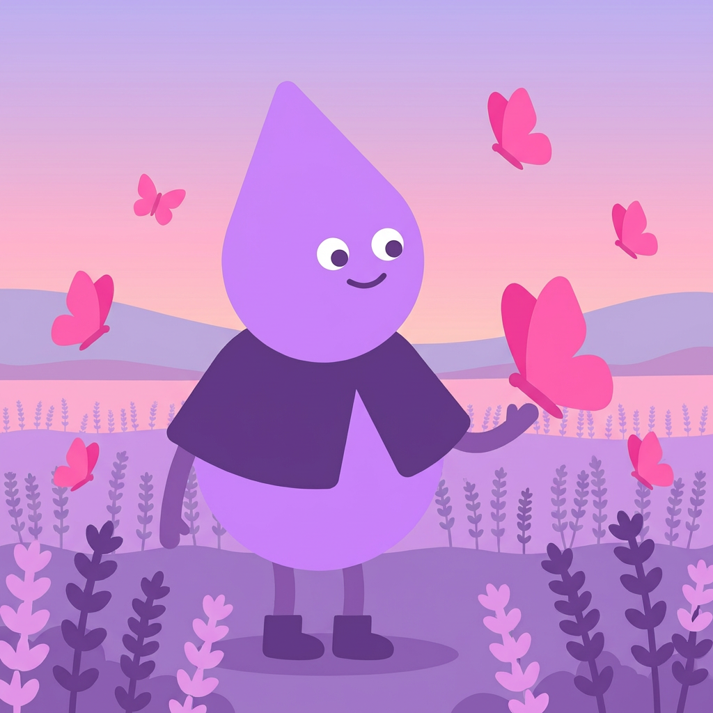 | 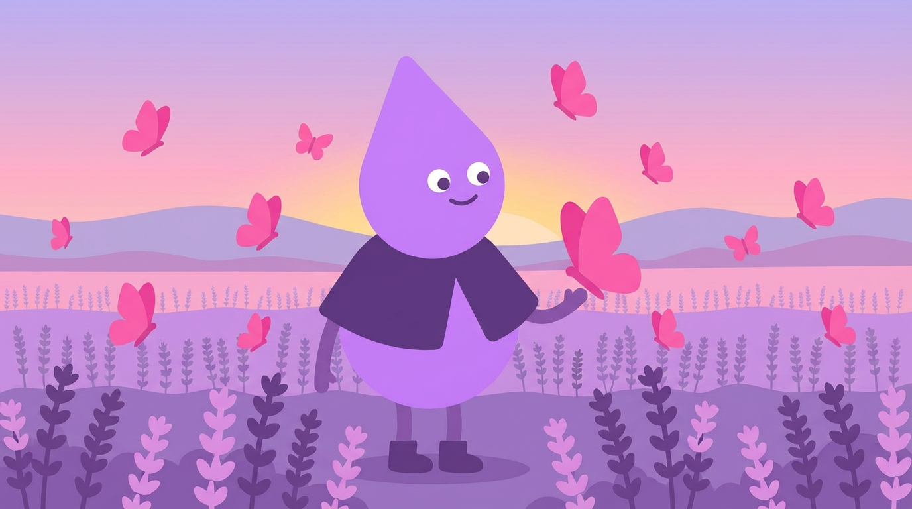 empath-01⭐ |
| **adventurer** | 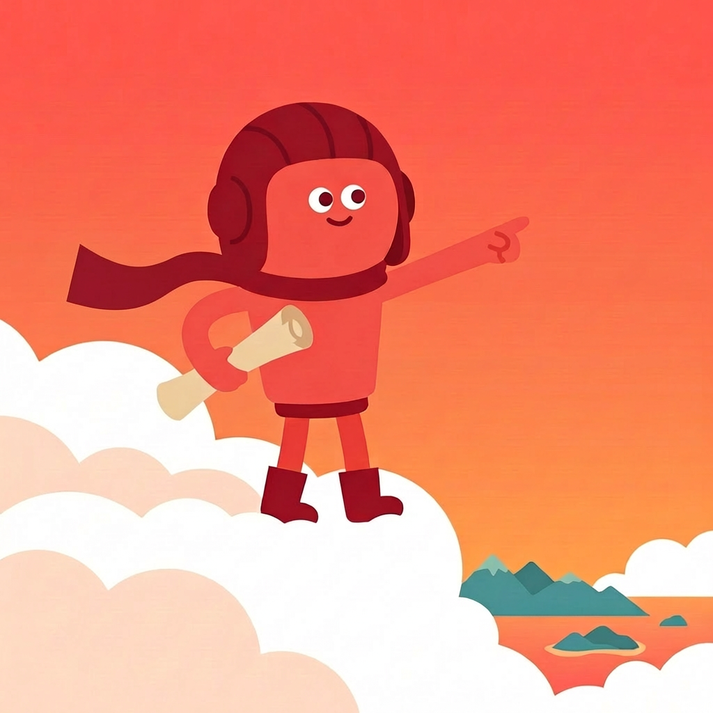 | 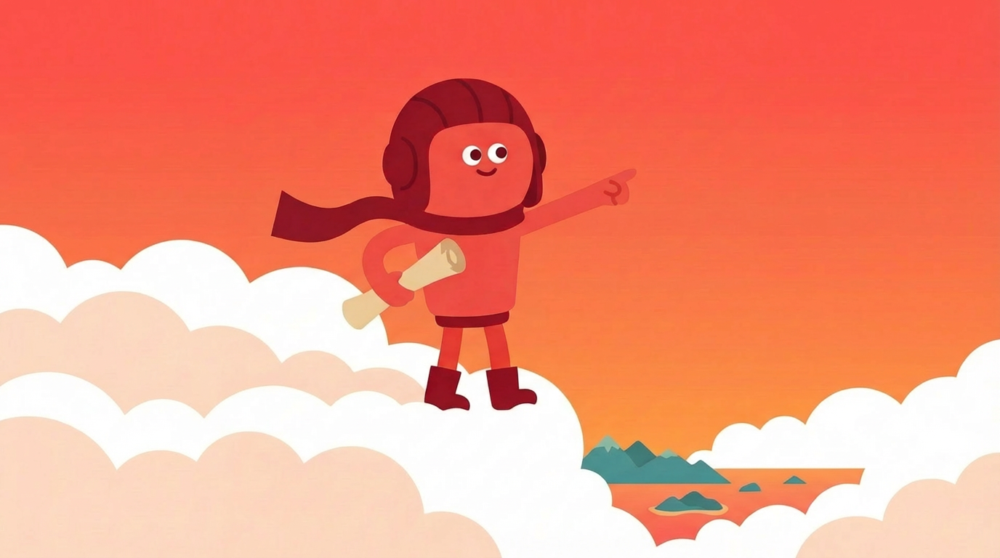 adventurer-01⭐ |
| **craftsman** | 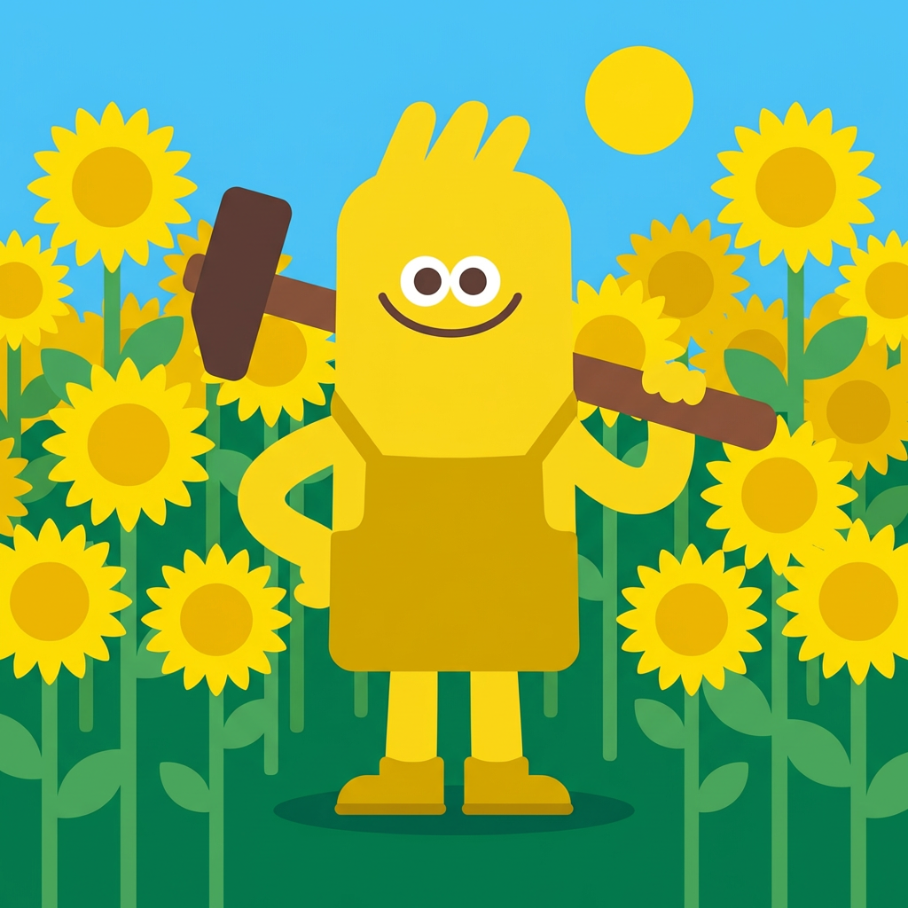 | 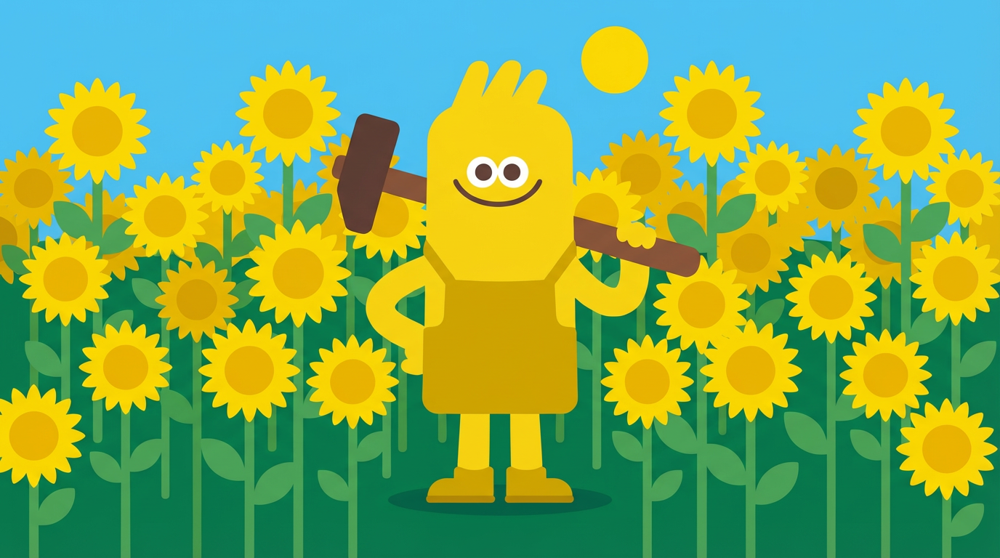 craftsman-01⭐ |
| **balancer** |  |  balancer-01⭐ |

