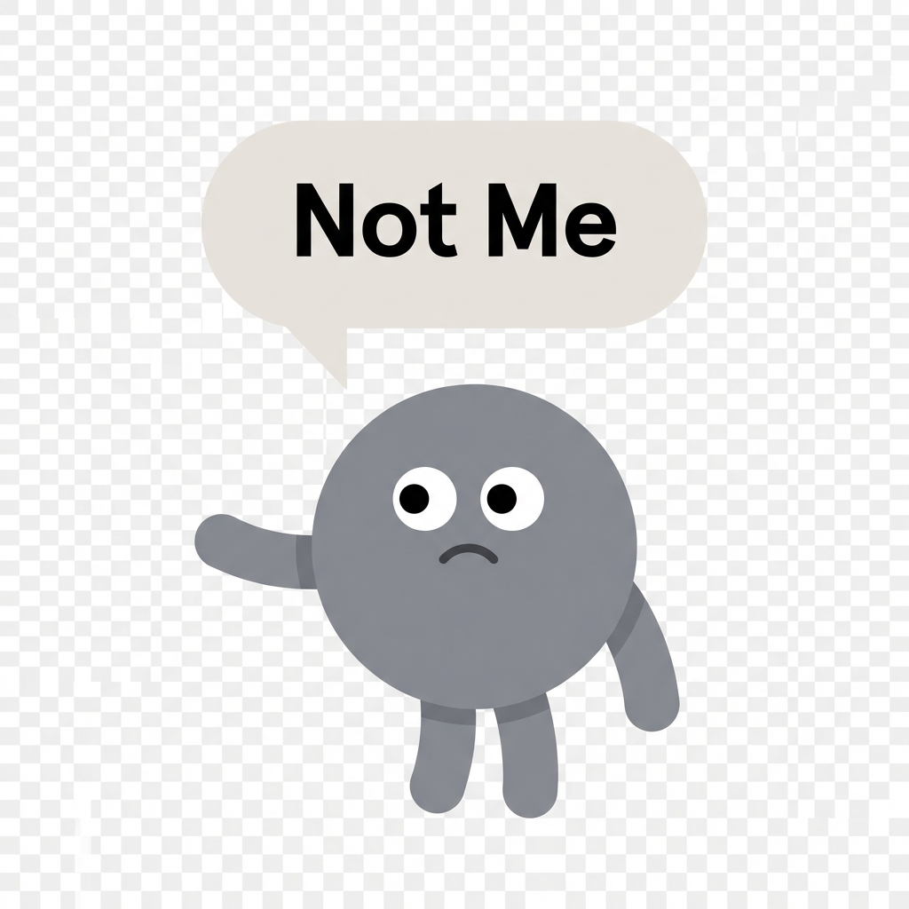
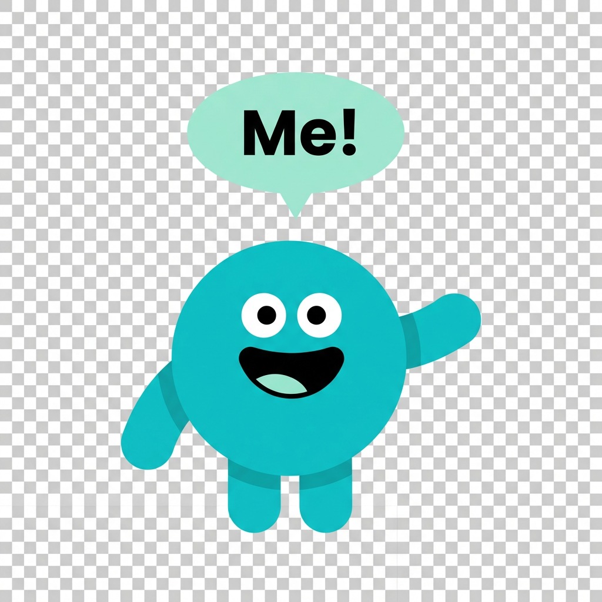

# スワイプヒントアイコン（2枚）

> スワイプ画面でカードの左右に表示される「Me!」「Not Me」のガイドアイコン。80×80px で表示される。

## デザイン方針

- **Headspaceスタイル:** 8体のキャラクターと同じ世界の住人
- **フラットデザイン:** 影なし・光沢なし・ベタ塗りカラー
- **シンプルな円形ボディ:** 80×80px で表示されるので細部よりインパクト重視
- **透過背景**

## アイコン仕様

| 項目 | left（Not Me） | right（Me!） |
|------|---------------|-------------|
| 役割 | 「今はちがう」を示す | 「今の私っぽい」を示す |
| カラー | グレー | シアン/ティール（アプリのプライマリカラー） |
| 表情 | 困り顔・不安そう | 笑顔・楽しそう |
| 目 | **白い丸目＋黒い瞳**（8体と同じスタイル） | **白い丸目＋黒い瞳**（8体と同じスタイル） |
| 手足 | **太くて丸い stubby limbs**（8体と同じ） | **太くて丸い stubby limbs**（8体と同じ） |
| ポーズ | 片手で左を指す | 片手で右を指す |
| 吹き出し | 「Not Me」（**薄いウォームグレー**バブル・黒太字） | 「Me!」（**薄いミント/ティール**バブル・黒太字） |
| 背景 | 透過 | 透過 |

## 共通プロンプト要件

上記仕様テーブルに従う。プロンプト用キーワード:

- `Headspace-style flat design character icon, transparent background`
- `simple circular body, flat fill single color`
- `white sclera eyes with black pupils, Headspace-style`
- `extremely thick, short, round stubby limbs, sausage-like, all 4 same thickness`
- `rounded rectangle speech bubble`
- `1:1 square, 1024×1024`
- `No shadows, no gloss, no gradients, no color variation, no line-drawn eyes, no thin limbs`

## 生成戦略

1. **left（グレー）**から生成 — 表情・手足の太さの基準を確立
2. left が◎になったら **right** を生成。left と対になるよう色・表情を変える
3. 2枚並べてレビュー。対比が弱い場合は片方を再生成

## レビュー観点

すべて◎を満たすまで再生成する。

| 観点 | 基準 | NG例 |
|------|------|------|
| かわいさ | パッと見て「かわいい！」。スワイプが楽しくなる | 無機質、怖い、気持ち悪い |
| Headspace世界観 | 8体のキャラと**同じ世界の住人**に見える。白丸目＋黒瞳、太い丸い手足、影なし光沢なし、ベタ塗り | 線画の表情、細い手足、影・光沢あり、emoji風 |
| 80px視認性 | 80×80px に縮小しても表情・吹き出しテキストがはっきり読める | 細部がつぶれる、文字が小さすぎ |
| Yes/No対比 | left と right が「対」として成立。色・表情で瞬時に判別できる | 色が似すぎ、表情の差が弱い |

## ファイル構成

- **プロンプト・生成設定:** [`scripts/prompts/swipe-hint/prompts.json`](../../scripts/prompts/swipe-hint/prompts.json)
- **生成スクリプト:** [`scripts/gen-swipe-hints.mjs`](../../scripts/gen-swipe-hints.mjs)
- **格納先:** `public/images/swipe-hints/`
- **使用箇所:** `src/app/swipe/page.tsx`（カード左右に absolute 配置）

```bash
# プロンプト指定で生成（試行自動記録）
node scripts/gen-swipe-hints.mjs left --prompt "..." --temp 0.4
node scripts/gen-swipe-hints.mjs right --prompt "..."

# JSONから再生成（全アイコン or 指定キー）
node scripts/gen-swipe-hints.mjs
node scripts/gen-swipe-hints.mjs left
```

## ギャラリー

### 採用

| left（Not Me） | right（Me!） |
|---------------|-------------|
|  |  |
| swipe-left-03 ⭐ | swipe-right-04 ⭐ |

