# スワイプ用画像（80枚）

> スワイプ画面でユーザーが「今の私っぽい / 今はちがう」を判断するためのイメージカード。5特性 × 2方向（high/low）× 8枚。

## デザイン方針

- **フラットミニマル:** シンプルな幾何学的形状、限られたカラーパレット（3〜4色）、ベクターアートスタイル
- **人物NG:** 人間・キャラクターは描かない。モチーフだけで特性の概念を表現する
- **テキストNG:** 文字・単語・記号は含めない。画像だけで伝わること
- **ポジティブな印象:** どの画像も「これ私っぽい！」とスワイプしたくなる魅力があること。ネガティブすぎる画像はスワイプされにくく、スコアにバイアスが生まれる
- **パステル背景:** ソリッドなパステルカラーの背景。白や派手な色は避ける

## 画像仕様

| 項目 | 値 |
|------|-----|
| 形式 | JPEG |
| アスペクト比 | 1:1 |
| 生成サイズ | 1024×1024（Gemini 出力） |
| 配信サイズ | 512×512（sharp でリサイズ、quality 85） |
| 枚数 | 80枚（5特性 × 2方向 × 8枚） |
| 格納先 | `public/images/swipe/` |
| メタデータ | `src/data/images.json`（id, src, trait, direction） |

## 共通プロンプト要件

commonPrefix として全画像に付与:

```
flat minimal icon, simple geometric shapes, limited color palette 3-4 colors,
NO people NO humans NO characters, NO text NO words NO letters NO writing,
solid pastel background, vector art style,
```

**絶対NG:** 人物、テキスト、リアルな質感、写真風、暗いトーン

## 特性別コンセプト一覧

### Openness（開放性）

| # | 方向 | コンセプト | プロンプト概要 |
|---|------|-----------|---------------|
| 01 | high | アートキャンバスと筆 | abstract art canvas with colorful paint splashes |
| 02 | high | 望遠鏡と宇宙探索 | telescope pointing at stars and galaxies |
| 03 | high | 魔法が飛び出す本 | open book with magical elements floating out |
| 04 | high | 世界地図と飛行機ルート | world map with airplane routes |
| 05 | high | ヴィンテージカメラ | vintage camera and film roll |
| 06 | high | ピアノと音符 | piano keys with colorful musical notes |
| 07 | high | カラフルな凧 | colorful kite flying in the wind |
| 08 | high | 蝶のコレクション | butterfly collection display |
| 01 | low | 急須と湯呑み | traditional teapot and cup |
| 02 | low | 白いフェンスの家 | home with white picket fence |
| 03 | low | レシピ本とキッチン | recipe book and kitchen utensils |
| 04 | low | 写真立てと時計 | family photo frame and clock |
| 05 | low | スリッパと暖炉 | cozy slippers and fireplace |
| 06 | low | 整然とした花壇 | neat flower garden with rows |
| 07 | low | 鍵と日記帳 | old key and locked diary |
| 08 | low | ラジオとロッキングチェア | vintage radio and rocking chair |

### Conscientiousness（誠実性）

| # | 方向 | コンセプト | プロンプト概要 |
|---|------|-----------|---------------|
| 01 | high | カレンダーとチェックリスト | organized desk with calendar, checklist |
| 02 | high | ラベル付き本棚 | neatly arranged bookshelf with labeled folders |
| 03 | high | 時計とスケジュール帳 | clock and schedule planner |
| 04 | high | トロフィーとメダル | trophy and medal, achievement |
| 05 | high | 的に刺さった矢 | target with arrow hitting bullseye |
| 06 | high | 整頓された工具箱 | neatly organized toolbox |
| 07 | high | 積み上がったコイン | stacked coins in ascending order |
| 08 | high | コンパスと地図 | compass and folded map with marked route |
| 01 | low | 散らかったアートデスク | messy artist desk, creative chaos |
| 02 | low | 曲がりくねった道 | winding road with no signs |
| 03 | low | ギターと即興 | guitar and music notes floating freely |
| 04 | low | サイコロとトランプ | dice and playing cards |
| 05 | low | ハンモック | hammock between two palm trees |
| 06 | low | サーフボード | surfboard leaning on beach |
| 07 | low | スケートボード | skateboard with colorful wheels |
| 08 | low | 紙飛行機 | paper airplane flying freely |

### Extraversion（外向性）

| # | 方向 | コンセプト | プロンプト概要 |
|---|------|-----------|---------------|
| 01 | high | 風船と紙吹雪 | balloons and confetti, celebration |
| 02 | high | マイクとステージ | microphone and stage lights |
| 03 | high | コーヒーカップ（交流） | coffee cups together, social gathering |
| 04 | high | 花火とお祭り | fireworks and festival decorations |
| 05 | high | メガホン | megaphone with sound waves |
| 06 | high | ミラーボール | disco ball with colorful lights |
| 07 | high | キャンプファイヤー | campfire with circle of chairs |
| 08 | high | ジェットコースター | roller coaster track loops |
| 01 | low | 肘掛け椅子で読書 | cozy armchair with book and lamp |
| 02 | low | キャンドルと瞑想 | single candle in peaceful room |
| 03 | low | 日記帳とお茶 | journal and pen with cup of tea |
| 04 | low | ヘッドホン | headphones and music player |
| 05 | low | 窓と雨粒 | window with raindrops, peaceful solitude |
| 06 | low | 眠る猫 | sleeping cat on soft cushion |
| 07 | low | 窓辺の鉢植え | single potted plant on windowsill |
| 08 | low | スノードーム | snow globe with miniature scene |

### Agreeableness（協調性）

| # | 方向 | コンセプト | プロンプト概要 |
|---|------|-----------|---------------|
| 01 | high | ハートを作る手 | hands holding heart shape |
| 02 | high | ギフトボックス | gift box with ribbon |
| 03 | high | パズルピース | puzzle pieces fitting together |
| 04 | high | 鳩とオリーブ | dove and olive branch |
| 05 | high | じょうろと花 | watering can pouring on flowers |
| 06 | high | 並ぶ小鳥 | birds sitting together on branch |
| 07 | high | 橋 | bridge connecting two sides |
| 08 | high | マフラーとミトン | warm knitted scarf and mittens |
| 01 | low | チェスの駒 | chess pieces in strategic position |
| 02 | low | 旗の立った山頂 | mountain peak with flag |
| 03 | low | ボクシンググローブ | boxing gloves |
| 04 | low | 王冠と玉座 | crown and throne |
| 05 | low | ロケット発射 | rocket launching upward |
| 06 | low | 剣と盾 | sword and shield crossed |
| 07 | low | 月に吠える狼 | wolf silhouette howling at moon |
| 08 | low | 稲妻 | lightning bolt striking |

### Neuroticism（繊細性）

| # | 方向 | コンセプト | プロンプト概要 | 備考 |
|---|------|-----------|---------------|------|
| 01 | high | 雨雲と傘 | rain clouds and umbrella | |
| 02 | high | 嵐の中の花 | delicate flower in storm | |
| 03 | high | 万華鏡 | kaleidoscope with delicate colorful patterns, intricate beauty |  |
| 04 | high | ガラス花瓶+光 | delicate blown glass vase with thin cracks, light shining through colored glass pieces |  |
| 05 | high | 岩に打ちつける波 | waves crashing on rocks | |
| 06 | high | 溶ける氷 | melting ice cube | |
| 07 | high | 砂時計 | hourglass with sand running out | |
| 08 | high | 雨上がりの虹 | bright rainbow arc after rain, small raindrops in the air, hopeful and gentle mood |  |
| 01 | low | 夕日の穏やかな海 | calm ocean with sunset | |
| 02 | low | 禅の石 | balanced zen stones | |
| 03 | low | 錨と船 | anchor and steady ship | |
| 04 | low | 青空と雲 | clear blue sky with single cloud | |
| 05 | low | 山の湖と映り込み | still mountain lake with reflection | |
| 06 | low | 霧の中の灯台 | lighthouse beam in gentle fog | |
| 07 | low | 深い根の大木 | large tree with deep roots | |
| 08 | low | 地平線の日の出 | sunrise over peaceful horizon | |

### 既知の課題

**neuroticism high のネガティブバイアス回避:**
繊細性を表すモチーフは、ネガティブに偏らないよう注意が必要。万華鏡（繊細な美しさ）、ガラス花瓶+光（儚さと美しさ）、雨上がりの虹（希望）のようにポジティブな表現を選ぶ。

**コンセプト重複（軽微）:**
- ピアノ（O-high）↔ ギター（C-low）: 音楽
- 世界地図（O-high）↔ コンパス地図（C-high）: 地図
- 凧（O-high）↔ 紙飛行機（C-low）: 飛ぶもの
- お茶（O-low）↔ 日記+お茶（E-low）: お茶

方向が逆なので大きな問題にはならないが、特定の趣味（音楽好き等）でスコアが偏る可能性はある。

## 生成戦略

1. commonPrefix で全画像のスタイルを統一
2. 各画像ごとに個別プロンプトで被写体を指定
3. 生成後 sharp で 1024→512 にリサイズ（JPEG quality 85）
4. `scripts/swipe/` にステージング出力 → 確認後 `--out public/images/swipe --force` で本番配置

## サイズ最適化

| 段階 | サイズ | 用途 |
|------|--------|------|
| 生成時 | 1024×1024 | Gemini の出力（imageSize: "1K"） |
| 配信時 | 512×512 | スワイプカード表示（実際の表示は最大320px、Retina対応で2x） |

512×512 を選んだ理由:
- スワイプカードの CSS 最大幅は `min(320px, calc(100vw - 48px))`
- Retina（2x）対応で 640px が理想だが、512px でも十分な品質
- 1024→512 で **ファイルサイズ約75%削減**（初期ロード高速化）

## レビュー観点

| 観点 | 基準 | NG例 |
|------|------|------|
| フラットスタイル統一 | 80枚すべてが同じスタイル（パステル背景・ベクター・影なし） | リアルすぎる、写真風、影つき |
| 特性との対応 | 画像を見て直感的に特性（high/low）が伝わる | 開放性 high なのに保守的な印象 |
| ポジティブな印象 | どの画像も「これ選びたい！」と思える魅力がある | 暗い、怖い、不快 |
| 判別容易性 | 同特性の8枚がそれぞれ異なるモチーフで区別できる | 似たモチーフが複数ある |
| テキストなし | 文字・数字・記号が含まれていない | チェックリストに文字が入っている |

## ファイル構成

- **設計書:** `docs/design/swipe-image.md`（本ファイル）
- **生成スクリプト:** [`scripts/gen-swipe.mjs`](../../scripts/gen-swipe.mjs)
- **プロンプト・生成設定:** `scripts/prompts/swipe-image/prompts.json`
- **試行ファイル:** `scripts/swipe/`
- **格納先:** `public/images/swipe/`
- **メタデータ:** `src/data/images.json`
- **使用箇所:** `src/app/swipe/page.tsx`

```bash
# 特定キーのみ生成（ステージングに出力）
node scripts/gen-swipe.mjs neuroticism_high_03 --force

# 特性で絞り込み
node scripts/gen-swipe.mjs --trait neuroticism --direction high --force

# 本番配置
node scripts/gen-swipe.mjs --out public/images/swipe --force

# リサイズのみ（生成なし、既存画像を一括最適化）
node scripts/gen-swipe.mjs --resize-existing --size 512
```

## ギャラリー

prompts.json の 80枚を使用。`scripts/prompts/swipe-image/prompts.json` にプロンプト全記録。

## 全80枚ギャラリー

5段階評価: S=最高 / A=良い / B=許容 / C=要改善 / D=差し替え必須

観点: スタイル統一感 / 特性との対応 / ポジティブな印象 / モチーフの判別しやすさ / テキストなし

### Openness（開放性）

| # | 方向 | 画像 | コンセプト | 評価 | コメント |
|---|------|:----:|-----------|:----:|---------|
| 01 | high | 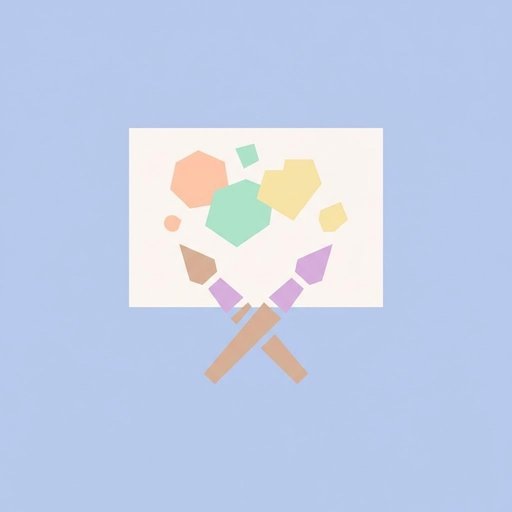 | アートキャンバスと筆 | S | 幾何学パステルスプラッシュ+クロス筆。開放性が華やかに伝わる |
| 02 | high |  | 望遠鏡と宇宙 | S | 色使い・構図ともに最高。探究心が伝わる |
| 03 | high |  | 魔法が飛び出す本 | S | 想像力のシンボルとして完璧。パステルも美しい |
| 04 | high | 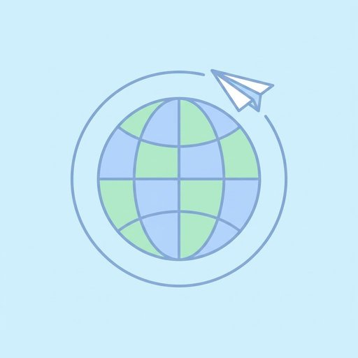 | 地球儀と紙飛行機 | S | シンプルな地球儀+紙飛行機周回。ミニマルで探究心が伝わる |
| 05 | high | 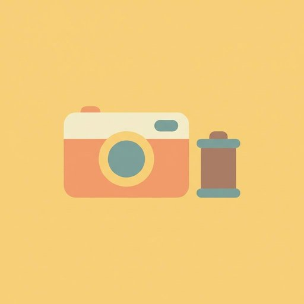 | レトロカメラ | S | アウトラインなしフラット。暖かい黄色背景で統一感◎ |
| 06 | high | 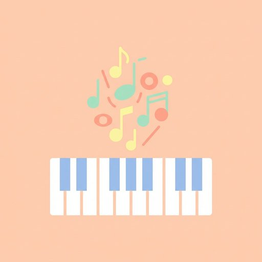 | ピアノと音符 | S | パステルカラーの音符が美しい。創造性がストレートに伝わる |
| 07 | high | 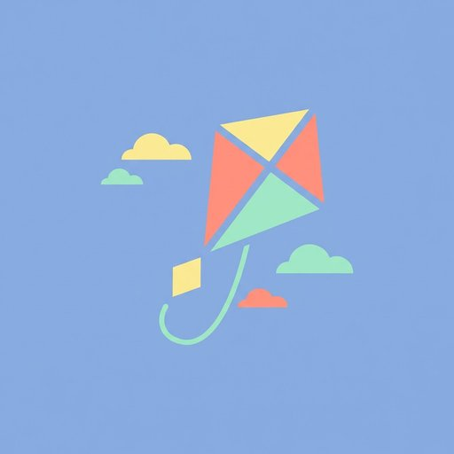 | カラフルな凧 | S | シンプルで爽やか。自由さと遊び心がぴったり |
| 08 | high | 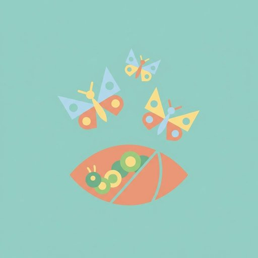 | 蛹から蝶の変態 | S | 正方形構図で蛹→蝶3匹が上昇。変化・成長のストーリー |
| 01 | low | 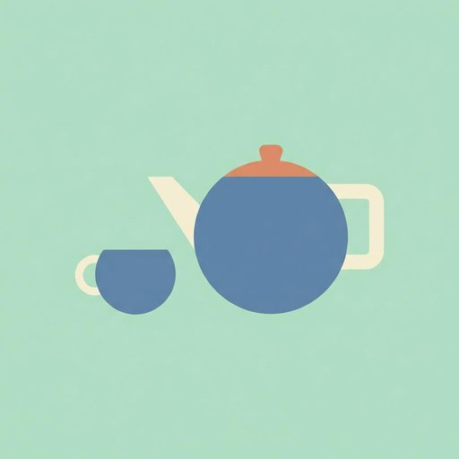 | 急須と湯呑み | S | 超シンプルで美しい。伝統・安定感が完璧に伝わる |
| 02 | low | 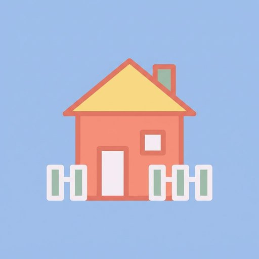 | 白いフェンスの家 | S | かわいい。安心感・日常の象徴として最高 |
| 03 | low |  | レシピ本と調理器具 | S | テキスト行なし。スプーン&泡立て器クロス+ハーブの葉 |
| 04 | low | 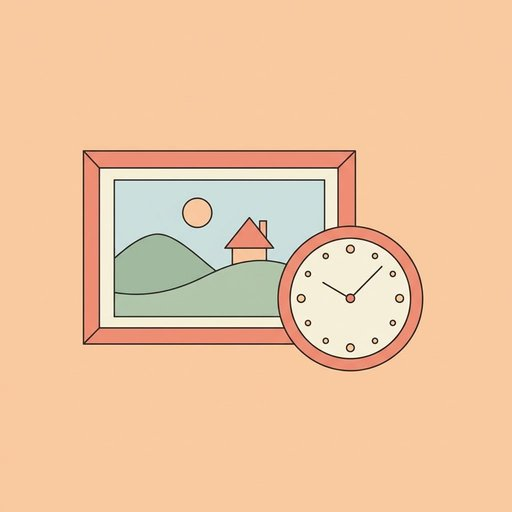 | 額縁と時計 | S | ピーチ背景で温かみ。額の中に家と丘の風景 |
| 05 | low | 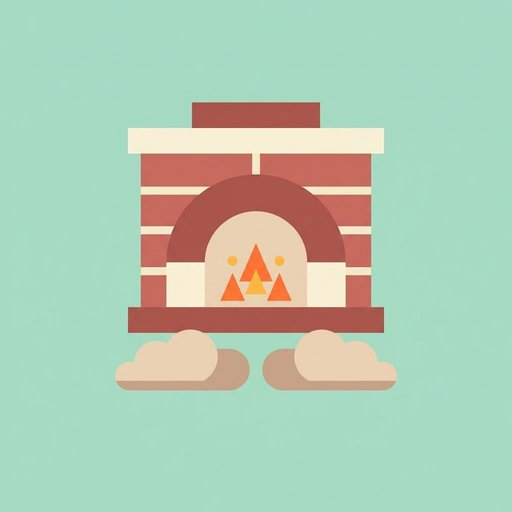 | 暖炉とスリッパ | S | 正面フラットビュー。レンガ暖炉+三角炎+もこもこスリッパ |
| 06 | low | 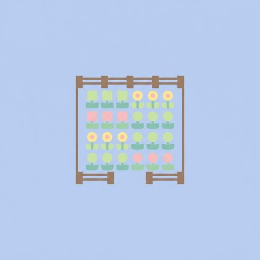 | フェンス付き花壇 | S | 中央に小さな花壇。整頓・規則性がミニマルに伝わる |
| 07 | low |  | ロック付き日記帳と鍵 | S | 枠なし。南京錠+ゴールド鍵で秘密感 |
| 08 | low | 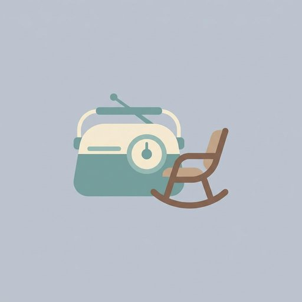 | ラジオとロッキングチェア | S | 網目模様なしシンプル。グレーブルー背景にノスタルジック |

### Conscientiousness（誠実性）

| # | 方向 | 画像 | コンセプト | 評価 | コメント |
|---|------|:----:|-----------|:----:|---------|
| 01 | high | 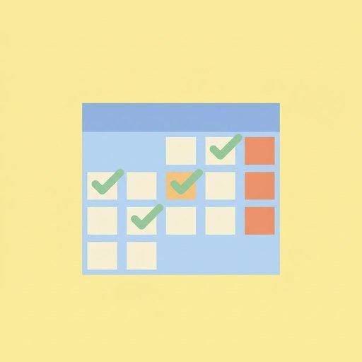 | カレンダーとチェックリスト | S | テキストなし数字なし。黄色背景にカラフルチェックマーク |
| 02 | high | 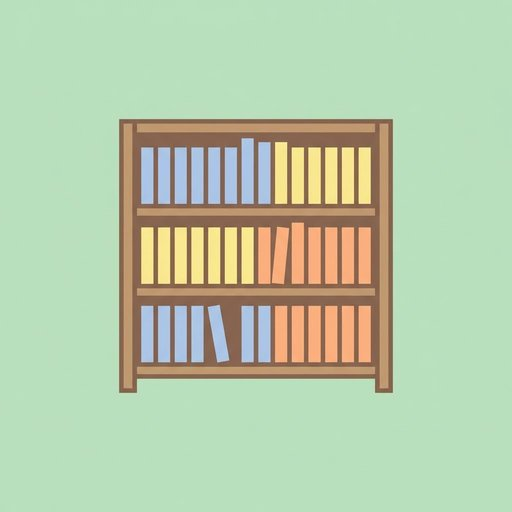 | 色分け本棚 | S | ラベルなし色分け3段。グリーン背景に整理整頓の象徴 |
| 03 | high |  | 砂時計とタスク完了 | S | 砂時計+チェックマーク+書類の山。N-high_07と完全に差別化 |
| 04 | high |  | トロフィーとメダル | S | 達成感が一目でわかる。パステルの金色が美しい |
| 05 | high |  | 的に刺さった矢 | S | インパクト大。集中力・目標達成を完璧に表現 |
| 06 | high |  | 整頓された工具箱 | S | 「整理整頓」の具現化。ピンク背景とのコントラストも良い |
| 07 | high | 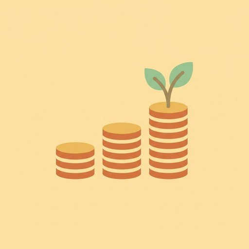 | 積み上がったコイン | S | 3段スタック+頂上に芽。矢印なし、自然な成長表現 |
| 08 | high | 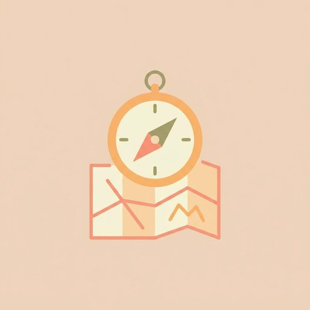 | コンパスと地図 | S | 暖色ベージュ背景に鮮やかなコンパス+地図。方向性が明確 |
| 01 | low | 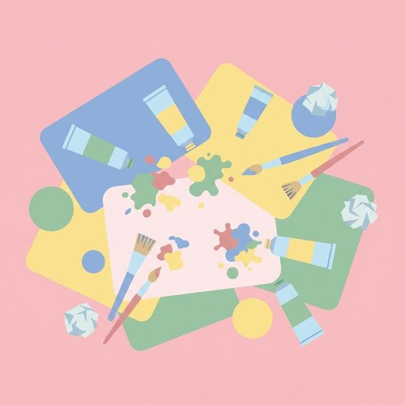 | 散らかったアートデスク | S | 俯瞰で絵の具チューブ+筆+スプラッシュ。creative chaosが最高 |
| 02 | low | 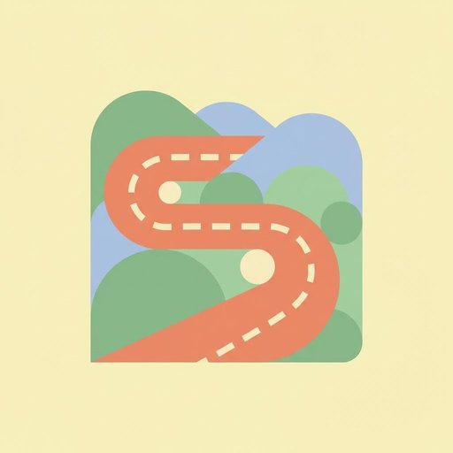 | 曲がりくねった道 | S | 自由さ・型にはまらない感じが最高。色使いも美しい |
| 03 | low | 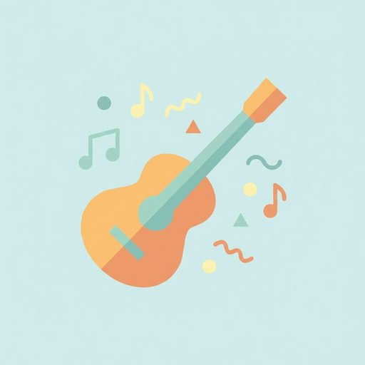 | ギターと即興 | S | 音符が自由に飛んでいて楽しい雰囲気 |
| 04 | low | 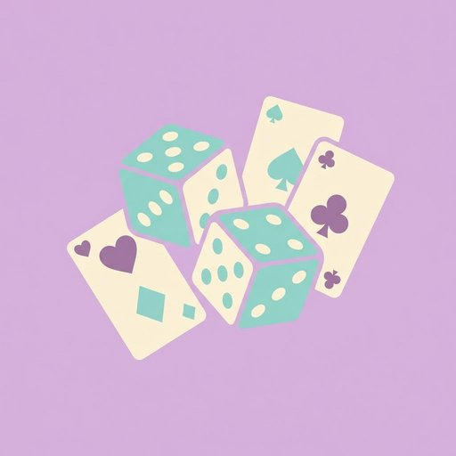 | サイコロとトランプ | S | パステルパープル+ミントのサイコロ&カード。統一感のある配色 |
| 05 | low |  | ハンモック | S | 最高にリラックス。パステルカラーも完璧 |
| 06 | low | 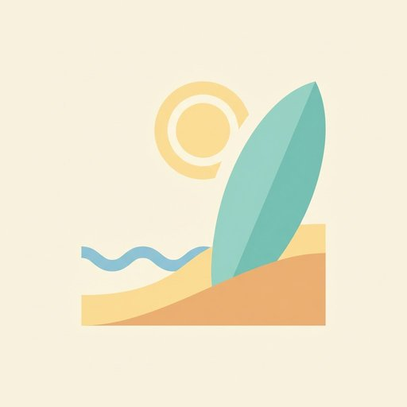 | サーフボード | S | 自由・海・冒険。構図もスタイルも美しい |
| 07 | low | 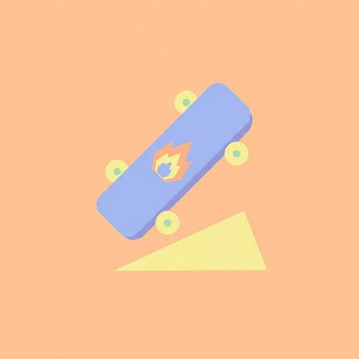 | スケートボード | S | 炎ステッカー+ランプ。矢印なし、オレンジ背景でポップ |
| 08 | low |  | 紙飛行機 | S | シンプルで最高。自由に飛ぶ感じが完璧 |

### Extraversion（外向性）

| # | 方向 | 画像 | コンセプト | 評価 | コメント |
|---|------|:----:|-----------|:----:|---------|
| 01 | high | 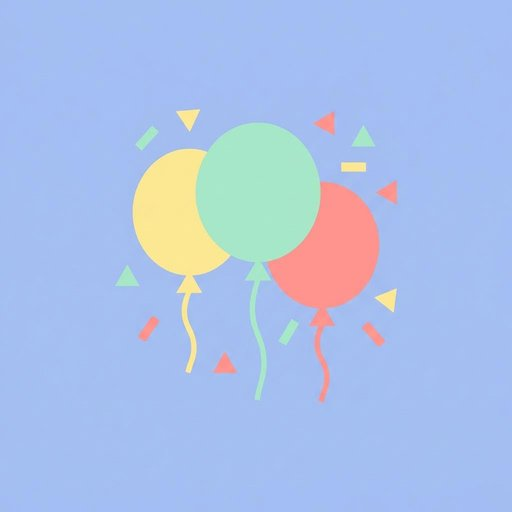 | 風船と紙吹雪 | S | お祝い・華やかさが一目でわかる。パステル配色も最高 |
| 02 | high |  | マイクとステージ | S | レトロマイク+スポットライト+放射状音符。ステージの華やかさが完璧 |
| 03 | high | 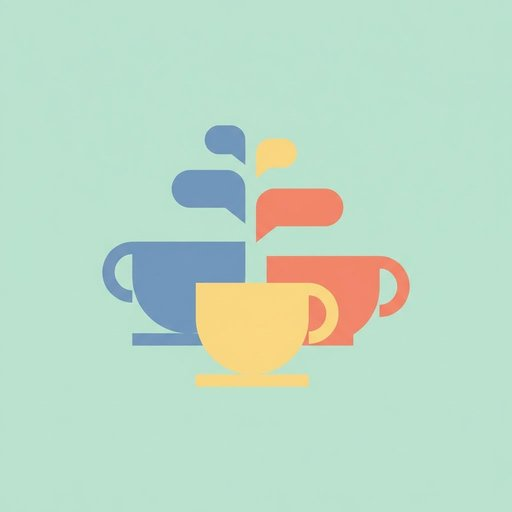 | コーヒーカップ（交流） | S | 吹き出し付きカップで「おしゃべり」が完璧に伝わる |
| 04 | high | 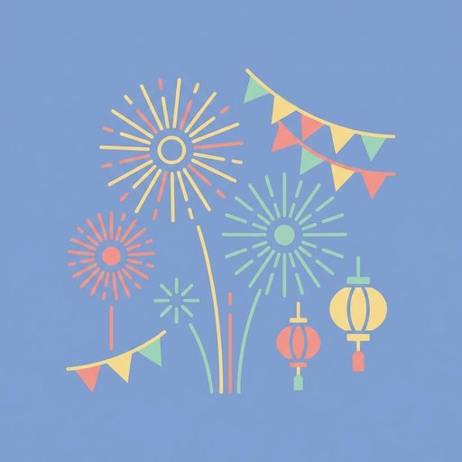 | 花火とお祭り | S | 華やか！提灯・ガーランドで祭りの雰囲気が最高 |
| 05 | high |  | メガホン | S | シンプルで力強い。音波の表現がいい |
| 06 | high | 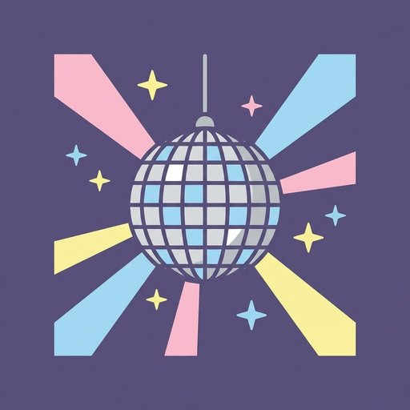 | ミラーボール | S | カラフル光線+キラキラ星。パープル背景にパーティー感爆発 |
| 07 | high | 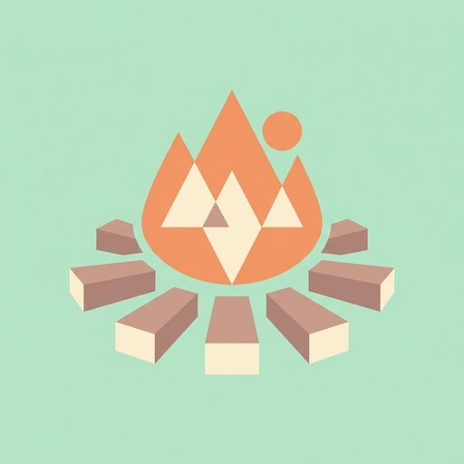 | キャンプファイヤー | S | 大きな炎+放射状の丸太で「集まり」が最高に伝わる |
| 08 | high | 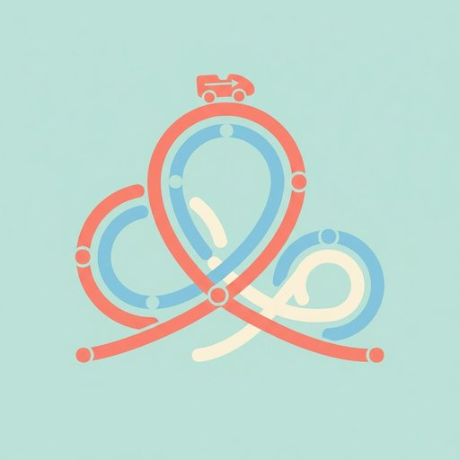 | ジェットコースター | S | 躍動感があって楽しい。線の絡まりがワクワク感を出している |
| 01 | low | 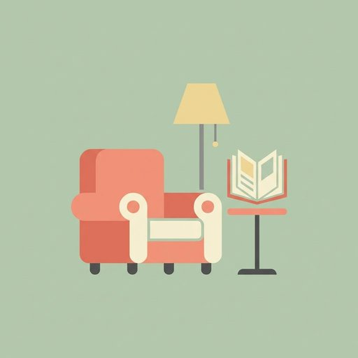 | 肘掛け椅子で読書 | S | 一人の時間の象徴として完璧。温かみのある配色 |
| 02 | low | 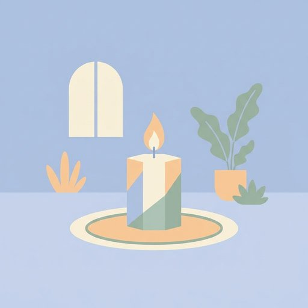 | キャンドルと瞑想 | S | 静けさ・内省が美しく表現されている |
| 03 | low | 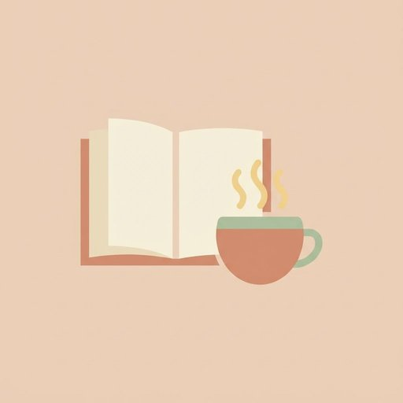 | 日記帳とお茶 | S | 開いた日記帳+湯気のお茶。反射なしフラット。ベージュ背景で温かみ |
| 04 | low |  | ヘッドホン | S | 「自分の世界」が一目で伝わる。色使いもポップ |
| 05 | low | 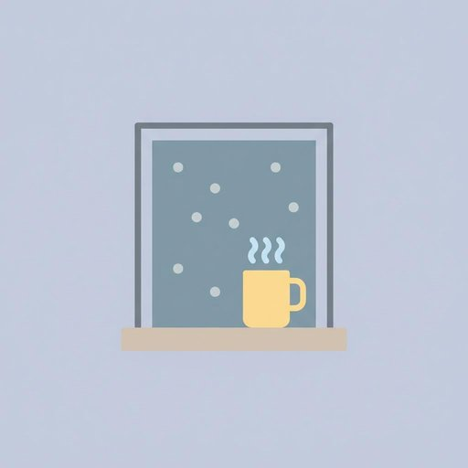 | 窓と雨粒 | S | 窓+雨粒+湯気のカップ。人影なし。ブルーグレーで静かな一人時間 |
| 06 | low | 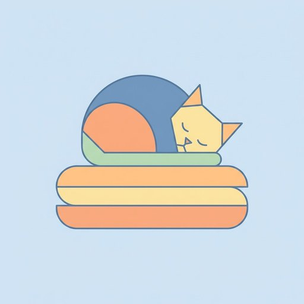 | 眠る猫 | S | かわいい！まったり感が最高。クッションの層も美しい |
| 07 | low | 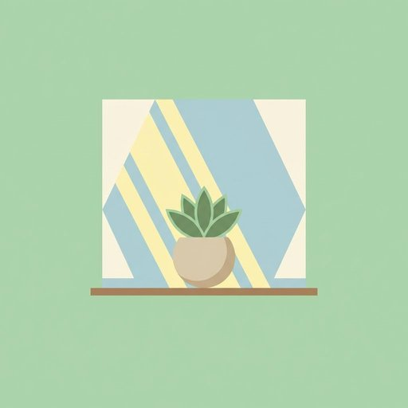 | 窓辺の多肉植物 | S | 多肉植物+日差し。A-high_05と明確に差別化 |
| 08 | low | 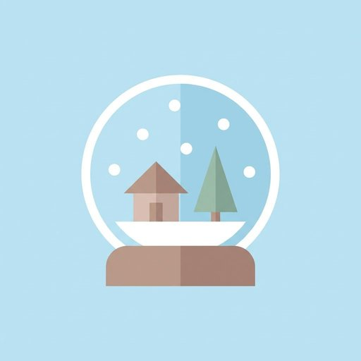 | スノードーム | S | 大きなスノードーム+家+木+雪。「自分だけの小さな世界」が完璧 |

### Agreeableness（協調性）

| # | 方向 | 画像 | コンセプト | 評価 | コメント |
|---|------|:----:|-----------|:----:|---------|
| 01 | high | 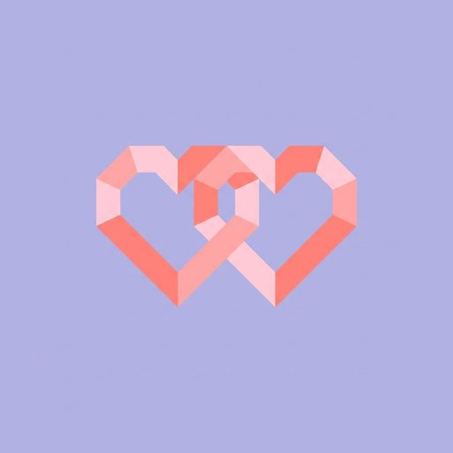 | 絡み合うハート | S | 幾何学的な2つのハート。手なし。ラベンダー背景にピンク+コーラル |
| 02 | high | 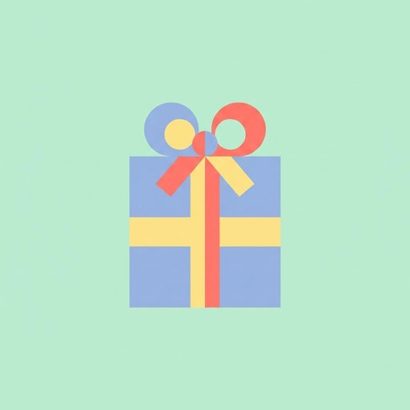 | ギフトボックス | S | シンプルで美しい。思いやり・贈り物が完璧に伝わる |
| 03 | high | 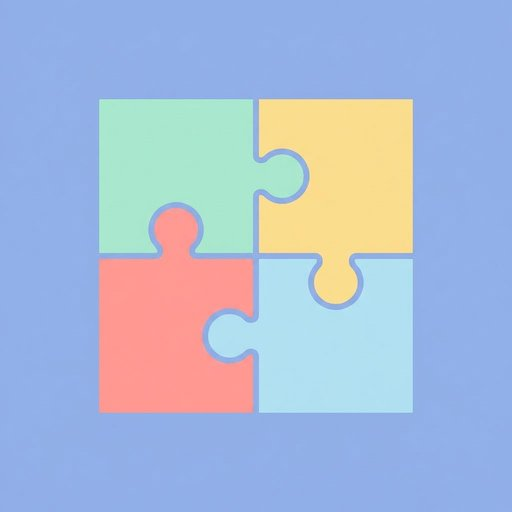 | パズルピース | S | 4色のピースが見事。つながり・協力が最高に表現されている |
| 04 | high | 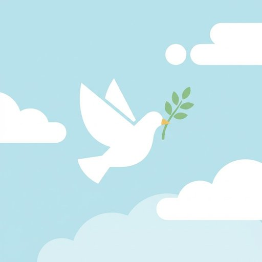 | 鳩とオリーブ | S | 白い鳩+オリーブの枝+青空+雲。明るく開放的 |
| 05 | high | 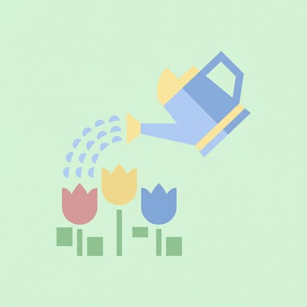 | じょうろと花 | S | 育てる・世話するイメージが完璧。色も華やか |
| 06 | high | 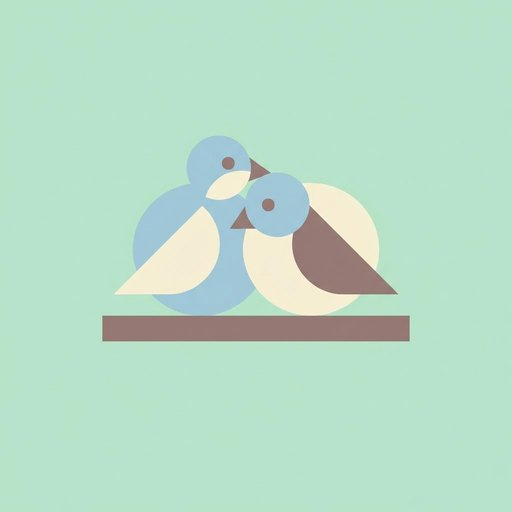 | 並ぶ小鳥 | S | 枠なし。ミント背景にフラットな2羽の小鳥 |
| 07 | high | 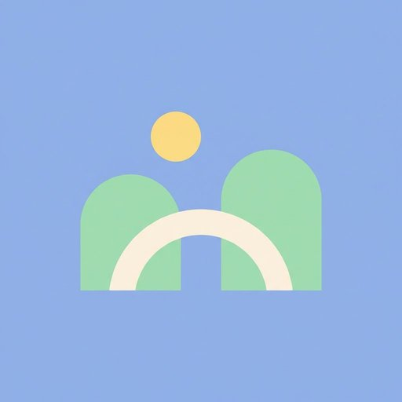 | 橋 | S | 2つの丘をつなぐアーチ橋+太陽。ミニマルで最高 |
| 08 | high | 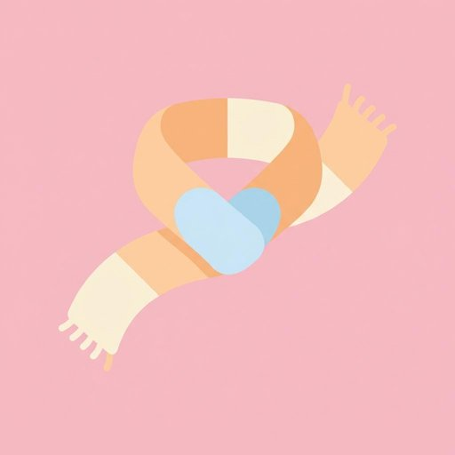 | ハート結びマフラー | S | マフラーがハート型に結ばれている。温かみ+つながりが協調性にぴったり |
| 01 | low |  | チェスの駒 | S | アウトラインなし。パステルブルー背景にフラットなチェス駒 |
| 02 | low | 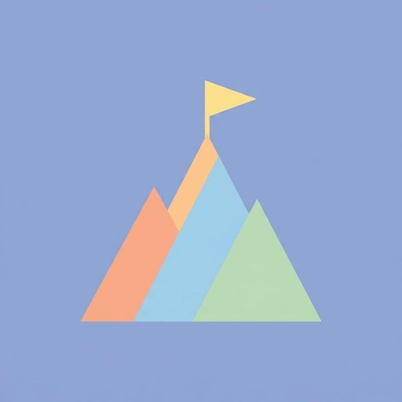 | 旗の立った山頂 | S | 征服・達成。シンプルで美しい三角構図 |
| 03 | low | 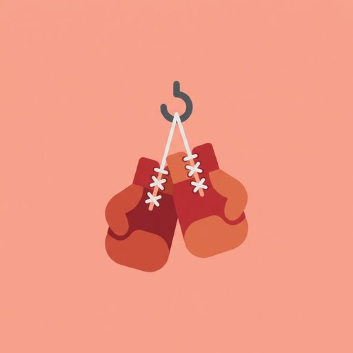 | ボクシンググローブ | S | フックにぶら下がるグローブ2つ。アウトラインなしフラット |
| 04 | low | 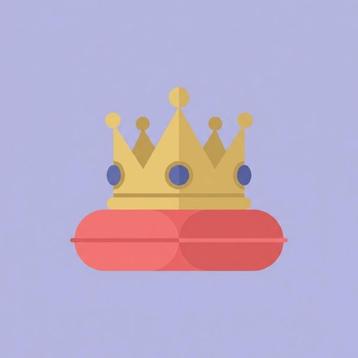 | 王冠とクッション | S | 金の王冠+赤いクッション。一目で「権威」とわかる |
| 05 | low |  | ロケット発射 | S | 独自路線・突破力が完璧。パステルロケットがかわいい |
| 06 | low | 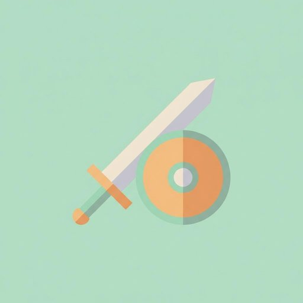 | 剣と盾 | S | 枠なしミントグリーン背景。アウトラインなしフラットで統一感◎ |
| 07 | low | 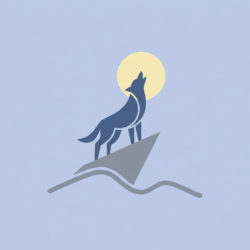 | 月に吠える狼 | S | 一匹狼の象徴として最高。シルエット表現が美しい |
| 08 | low | 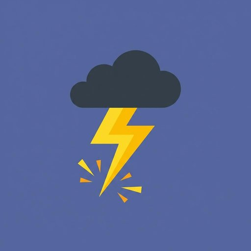 | 雷雲と稲妻 | S | 雷雲+稲妻+スパーク。形がくっきり。パワフル |

### Neuroticism（繊細性）

| # | 方向 | 画像 | コンセプト | 評価 | コメント |
|---|------|:----:|-----------|:----:|---------|
| 01 | high | 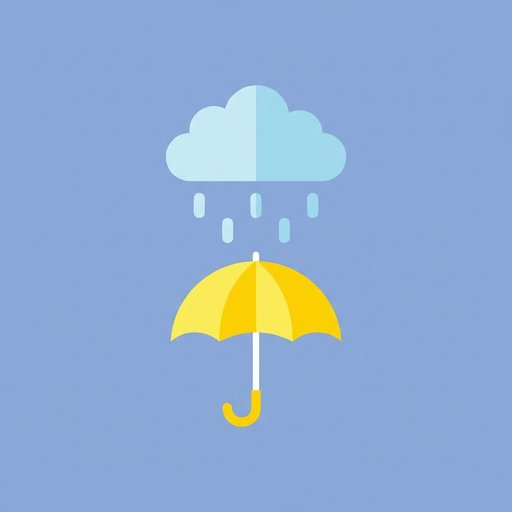 | 雨雲と傘 | S | シンプルな雲+雨粒+鮮やかな黄色い傘。完璧な中央配置 |
| 02 | high |  | 風に揺れる花 | S | そよ風に揺れる一輪の花。繊細さと儚さが完璧 |
| 03 | high |  | 万華鏡 | S | ラベンダー背景+中央に万華鏡ディスク。統一構図で繊細な美しさが完璧 |
| 04 | high |  | ガラス花瓶+光 | S | 花瓶+一輪の花+光の屈折がカラフルな三角形。繊細さと美しさ |
| 05 | high |  | うねる波 | S | 円形に渦巻く波。アウトラインなしブルー〜ティールが最高 |
| 06 | high |  | 溶ける氷 | S | ミニマルな氷+太陽光線+水たまり。ピーチ背景でポエティック |
| 07 | high |  | 砂時計と蝶 | S | エレガントな砂時計+小さな蝶。C-high_03と完全に差別化 |
| 08 | high |  | 雨上がりの虹 | S | パステルの虹がかわいく希望的。超シンプルで最高 |
| 01 | low |  | 夕日の穏やかな海 | S | 最高に穏やか。パステルピンクの空が美しい |
| 02 | low |  | 禅の石 | S | ミニマルで完璧。安定感・静寂が伝わる |
| 03 | low |  | 錨と船 | S | 大きな錨+ヨット+波。ネイビー+コーラルで存在感バッチリ |
| 04 | low |  | 青空と雲と小鳥 | S | ふわふわ雲3つ+小鳥。枠なし開放的で穏やか |
| 05 | low |  | 山の湖と映り込み | S | ピンク背景に山+完璧な鏡面反射。幾何学レイヤードで美しい |
| 06 | low |  | 霧の中の灯台 | S | 導きの光。構図・配色ともに最高 |
| 07 | low |  | 深い根の大木 | S | 丸い樹冠+地面から広がる根。ミニマルで安定感が完璧 |
| 08 | low |  | 地平線の日の出 | S | 穏やかな朝。希望を感じる美しい構図 |

### 統一感サマリー

| 観点 | 評価 | 詳細 |
|------|:----:|------|
| フラットスタイル | S | 全80枚フラットデザインで統一。アイソメトリック/反射表現なし |
| パステル背景 | S | 全枚パステル背景で統一。青系・緑系・ピンク系のバランスも良い |
| カラーパレット | S | 3〜4色ルールが守られている。赤黒の強い色なし |
| アウトライン | S | 太い黒アウトラインなし |
| 人物NG | S | 人影・手なし |
| テキストNG | S | テキスト要素なし。C-high_01のチェックマークは装飾的で許容 |
| モチーフの大きさ | S | 全枚画面中央にバランス良く配置 |


