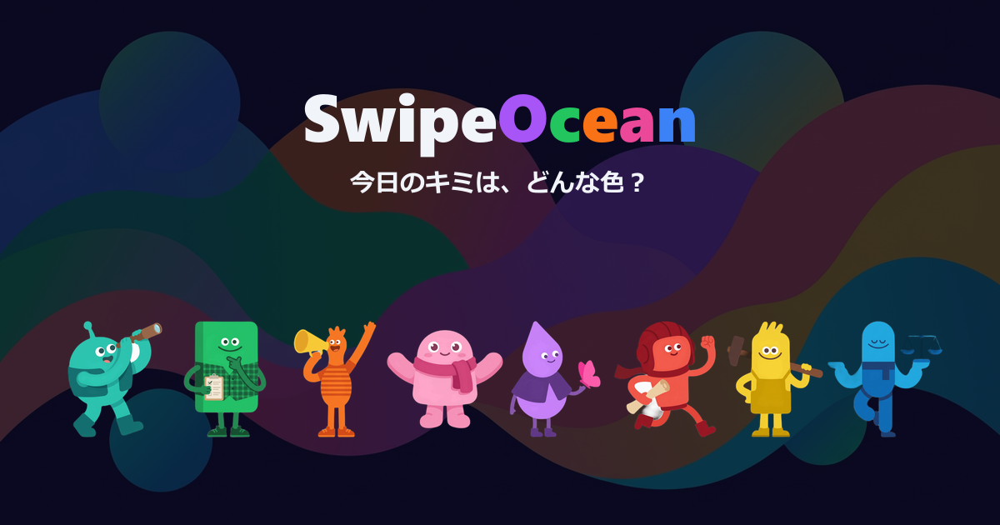

# トップOGPバナー（1枚）

> トップページ（`/`）をSNSシェアした際に表示されるOGP画像。キャラ8体集合 + ロゴでアプリの世界観を一目で伝える。

## デザイン方針

- **キャラ集合構図:** 8体のキャラクターを横一列〜ゆるいアーチ状に並べ、アプリの「8タイプ」を一目で伝える
- **Headspace世界観:** キャラクターと同じフラットデザイン。影なし・光沢なし・グラデーションなし（ロゴテキストのシアン→ブルーグラデは除く）
- **背景:** ダークネイビー `#0a0a1f`（トップページと同じ）。ヒーロー背景イラスト（`hero-top.png`）を薄く敷いてもOK
- **ロゴ + キャッチコピー:** 「Swipe Ocean」ロゴ + 「今日のキミ、どんな色？」を配置
- **SNS映え:** タイムラインで目を引く。カラフルなキャラの集合が主役

## 画像仕様

| 項目 | 値 |
|------|-----|
| サイズ | 1200 × 630 px |
| フォーマット | PNG |
| 枚数 | 1枚 |
| 背景 | ダークネイビー `#0a0a1f`（+ ヒーロー背景薄く敷き任意） |
| キャラクター | 8体全員（既存アセット `public/images/characters/type_{type}.png`） |
| テキスト | 「Swipe Ocean」ロゴ（シアン→ブルーグラデ）+ キャッチコピー（白 `#f1f5f9`） |
| フォント | Zen Maru Gothic Bold |

## 構図案

```
┌─────────────────────────────────────────────┐
│                                             │
│            Swipe Ocean                      │
│        今日のキミ、どんな色？              │
│                                             │
│   🟢  🟠  🟡  🟣  🔵  🩷  🔴  🩵          │
│  (8体のキャラクターを横に並べる)             │
│                                             │
└─────────────────────────────────────────────┘
```

- ロゴ: 上部1/3、中央揃え
- キャッチコピー: ロゴの直下
- キャラ: 下部1/2、横一列で等間隔。各キャラは元画像からトリミング配置
- キャラ並び順（左から）: explorer → planner → socialite → harmonizer → empath → adventurer → craftsman → balancer（トップページと同じ）
- 左右余白: 各60px以上

## 作成方法

`scripts/gen-top-ogp.mjs` でsharp合成。`gen-ogp.mjs` と同じパターン（commander CLI、sharp合成、フォントbase64埋め込み）。

### 合成パイプライン

```
ダークネイビー背景 (#0a0a1f, 1200×630)
  → hero-top.png を opacity 20% で overlay（--no-bg で省略可）
  → キャラ8体を 120×120 にリサイズ → 横一列に等間隔配置（y=410）
  → テキストSVG composite（ロゴ: シアン→ブルーグラデ、キャッチコピー: 白 #f1f5f9）
  → PNG出力 → scripts/ogp/top/top-NN.png（試行）
  → 確定後: --out public/images/ogp/top-ja.png --force で本番配置
```

### 素材

| 素材 | パス | サイズ |
|------|------|--------|
| キャラ8体 | `public/images/characters/type_{type}.png` | 600×600 |
| ヒーロー背景（任意） | `public/images/bg/hero-top.png` | 1200×675 |
| フォント | `scripts/fonts/ZenMaruGothic-Bold.ttf` | — |

## レビュー観点

すべて◎を満たすまで修正する。

| 観点 | 基準 | NG例 |
|------|------|------|
| Headspace世界観 | キャラクターと同じ世界に見える。温かく親しみやすい | 企業バナー的、無機質、キャラが浮いてる |
| SNS映え | タイムラインで目を引く。「タップして見たい」と思える。ダーク背景は白タイムラインで逆に目立つが、暗すぎてキャラが沈まないか要確認 | 暗い、地味、何のアプリかわからない、キャラが背景に溶け込む |
| 8体の視認性 | 8体全員がはっきり見える。重なりで埋もれない | キャラが小さすぎ、背景に溶け込む |
| テキスト可読性 | ロゴ・キャッチコピーが読みやすい | 背景と被って読めない、フォントが小さい |
| サイズ適正 | SNSサムネイル（小さい表示）でもキャラとロゴが識別できる | 大画面でしか判別できない |

## ファイル構成

- **設計書:** `docs/design/top-ogp-banner.md`（本ファイル）
- **生成スクリプト:** [`scripts/gen-top-ogp.mjs`](../../scripts/gen-top-ogp.mjs)
- **プロンプト・生成設定:** `scripts/prompts/top-ogp/prompts.json`
- **試行ファイル:** `scripts/ogp/top/`
- **格納先:** `public/images/ogp/top-ja.png`, `top-en.png`
- **使用箇所:** `src/app/layout.tsx`（`metadata.openGraph.images`）

```bash
# 試行生成（scripts/ogp/top/top-NN.png に連番出力）
node scripts/gen-top-ogp.mjs

# 基本生成
node scripts/gen-top-ogp.mjs

# ヒーロー背景なし
node scripts/gen-top-ogp.mjs --no-bg

# 出力先を指定
node scripts/gen-top-ogp.mjs --out scripts/ogp/top/test-01.png

# 確定版を本番配置
node scripts/gen-top-ogp.mjs --out public/images/ogp/top-ja.png --force
```

## メタデータ設定（バナー完成後）

`src/app/layout.tsx` に追加:

```ts
export const metadata: Metadata = {
  metadataBase: new URL("https://swipeocean.surf"),
  title: "Swipe Ocean - Personality Check",
  description: "Swipe images to discover your current vibe. Based on the Big Five (OCEAN) model — every type is a good one!",
  openGraph: {
    images: ["/images/ogp/top-ja.png"],
  },
  twitter: {
    card: "summary_large_image",
  },
};
```

## ギャラリー

| |
|:--:|
|  |
| ⭐21 |
