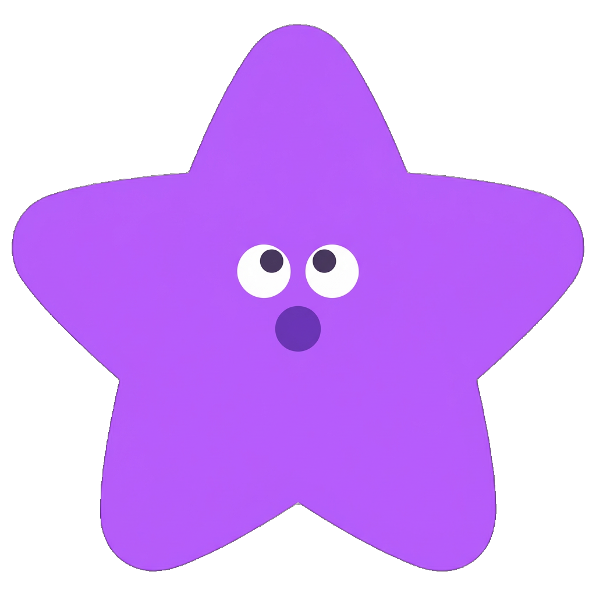
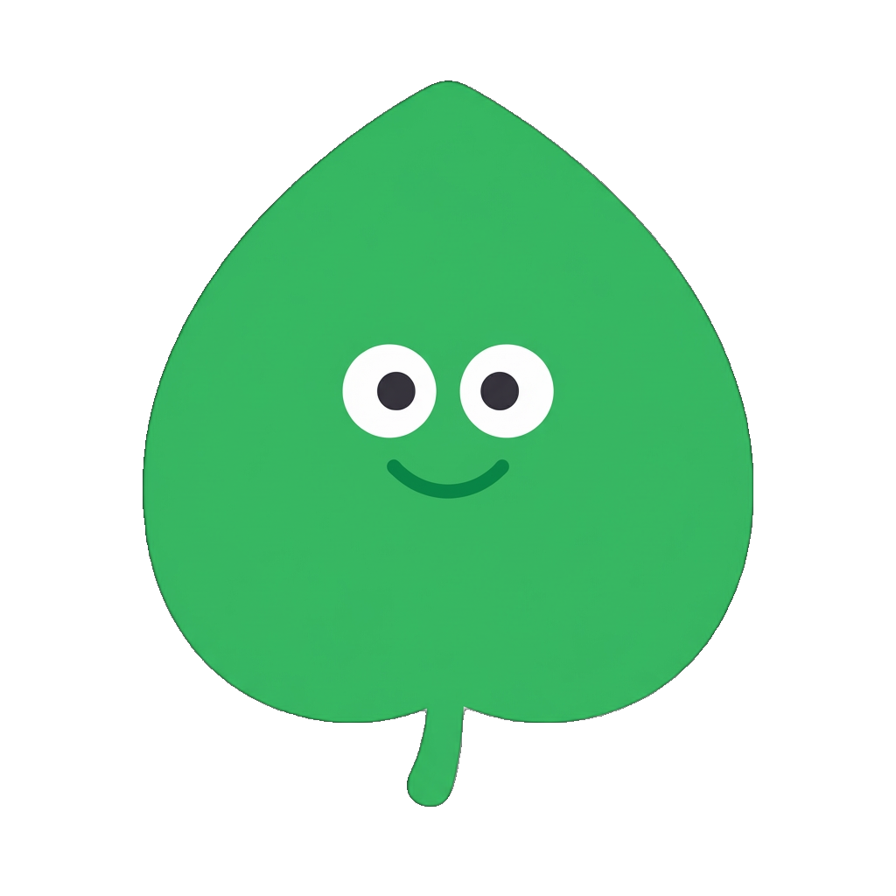
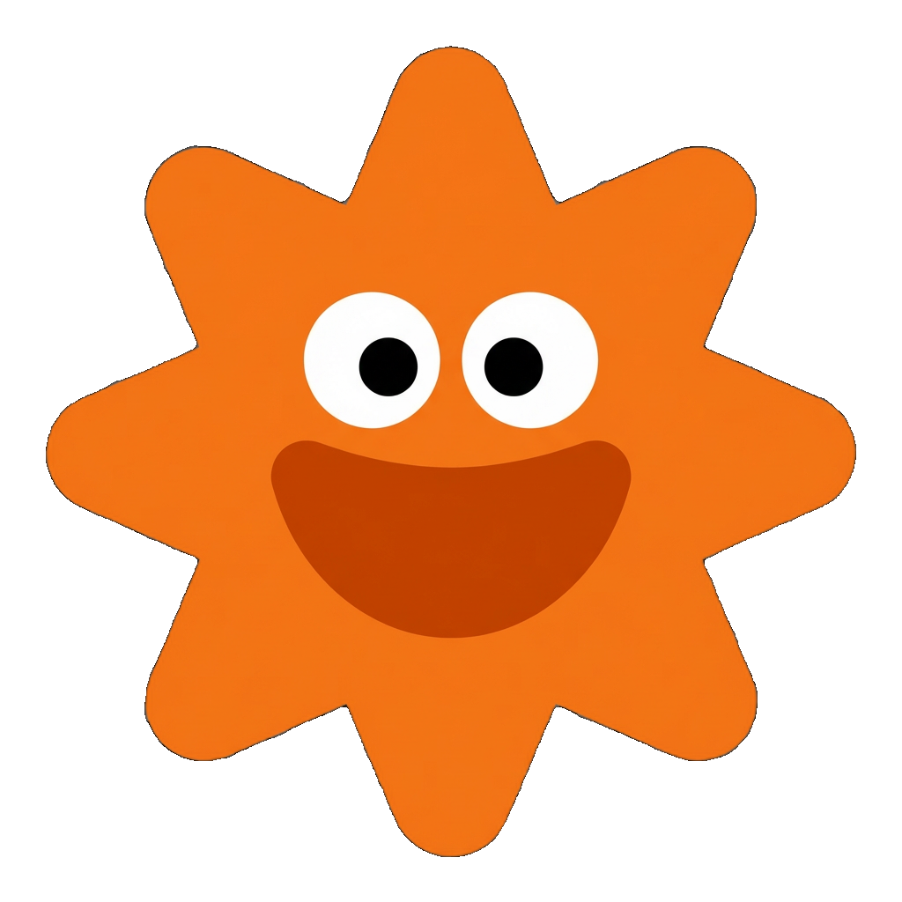
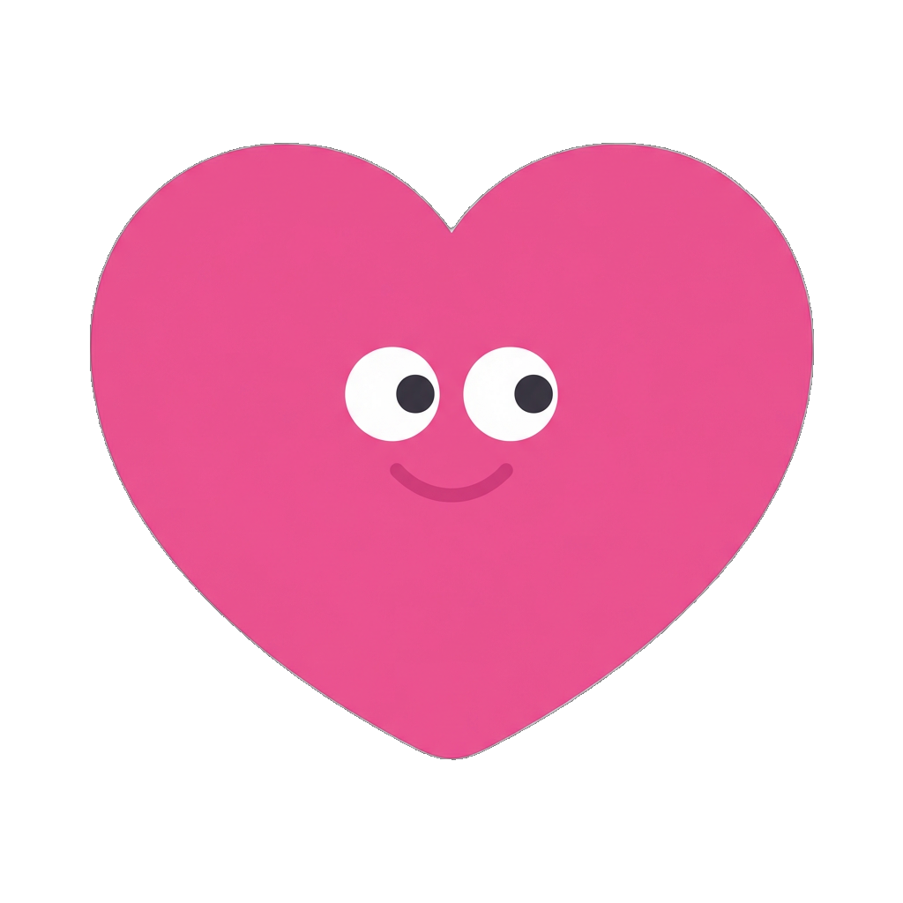
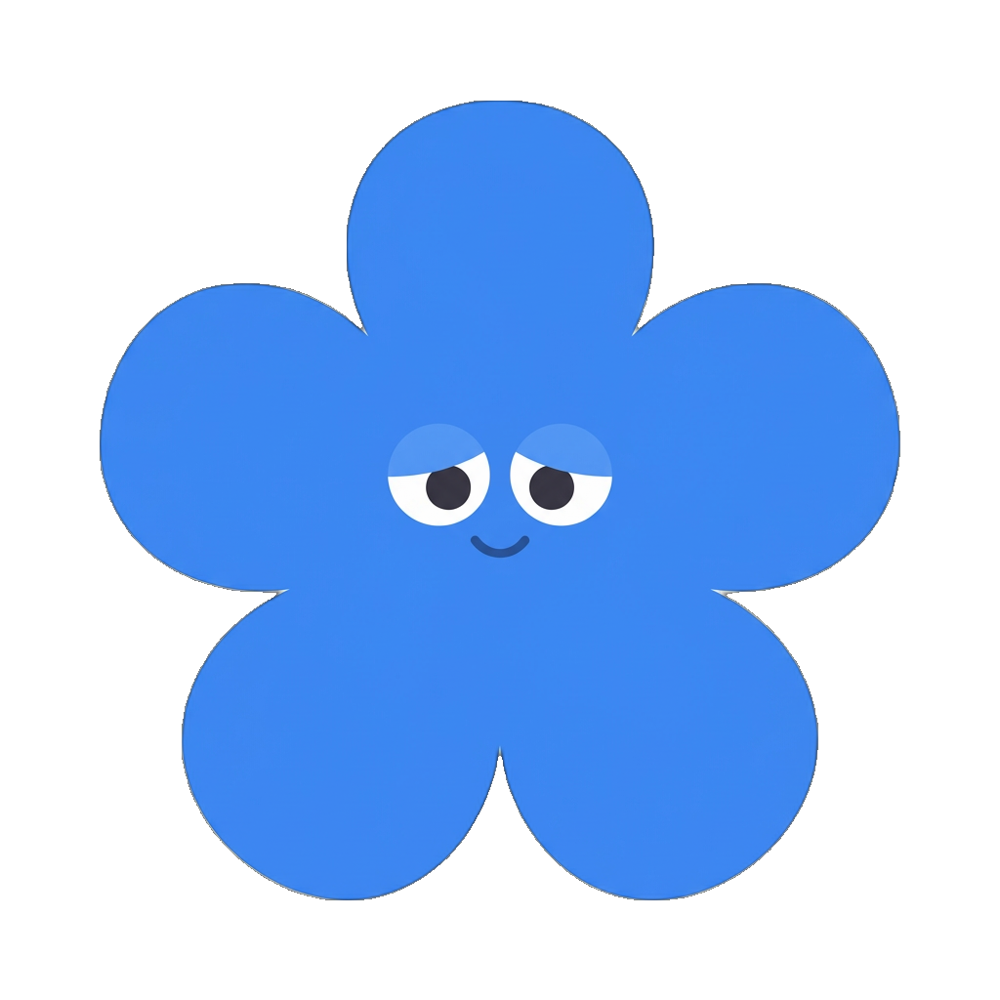

# 特性アイコン（5枚）

> 結果ページに表示される Big Five 特性のアイコン。8体のキャラクターと同じ世界の「ミニ仲間」。

## デザイン方針

- **キャラクター化されたモチーフ:** 自然モチーフ（ハート・星・太陽・葉っぱ・花）に**顔をつける**。体・手足はなし。モチーフの形がそのまま「体」
- **Headspaceスタイル:** 8体のキャラクターと同じ世界観。フラットデザイン、影なし・光沢なし・グラデーションなし
- **顔パーツ:** キャラクターと統一 — 白い丸い目（白い強膜＋黒い瞳）＋ シンプルな弧の口。特性ごとに表情が違う
- **カラー構成:** 特性カラーでモチーフを塗り＋顔パーツ（白目＋黒瞳＋口の線）
- **太く丸い形:** ぽってり・ぷっくり・やわらかい。Headspaceのイラストと同じ丸み
- **透過背景:** UIに自然になじむ
- **サイズ非依存:** 表示サイズに制約されず最高のデザインを追求。UIは後からアイコンに合わせる

## アイコン仕様

| 特性 | カラー | モチーフ | 表情 | 形状の具体的指示 | 意味 |
|------|--------|---------|------|-----------------|------|
| openness（開放性） | パープル `#a855f7` | 星 ✦ | 目を丸くした「おっ！」顔 | **ぽってりした4頂点の星。** 角は丸くぷっくり。口は小さな丸い開口（「おっ」と何かを発見した瞬間） | ひらめき・「知りたい！」の好奇心 |
| conscientiousness（誠実性） | グリーン `#22c55e` | 葉っぱ 🍃 | 誇らしげなにっこり顔 | **1枚の丸い大きな葉。** ぷっくり丸みのある葉の形。葉脈はなし。顔は葉の中心に。満足げな閉じ口の微笑み | 着実に育つ力・一歩一歩の成長 |
| extraversion（外向性） | オレンジ `#f97316` | 太陽 ☀ | 元気いっぱいの大笑い | **中心の丸い顔＋丸い光線6〜8本。** 光線は中心に接続した1つのシルエット。先端は丸い。口は大きく開いた笑顔 | 周りを温めるエネルギー |
| agreeableness（協調性） | ピンク `#ec4899` | ハート ♥ | やさしい微笑み | **ふっくら丸いハート。** 下の尖りも丸く処理。顔は中心やや上に。にこっとした優しい閉じ口 | つながり・そっと寄り添う思いやり |
| neuroticism（繊細性） | ブルー `#3b82f6` | 花 🌸 | ふんわり穏やかな顔 | **丸い花びら5〜6枚のシンプルな花。** 花びらはぷっくり丸い。顔は花の中心に。目は少し伏し目がちで穏やか、静かな微笑み | 繊細だけど美しい感受性・深く感じる心 |

**カラー:** コード内 `traitInfo.color` と同じ値を使用。

## 顔のデザインルール（キャラクターと統一）

8体のキャラクター（`character.md`）と同じ顔パーツスタイルを使う:

- **目:** 白い強膜＋黒い瞳のドット目。すべてのアイコンで同じ描き方
- **口:** シンプルな弧線 or 小さな開口。特性に合わせた表情バリエーション
- **顔の位置:** モチーフの中心〜やや上
- **顔のサイズ:** モチーフ全体の25〜30%程度。主役はあくまでモチーフの形
- **顔の色:** 目の白 = `#FFFFFF`、瞳 = `#000000`、口 = 特性カラーの濃い色（キャラクターと同じ手法）

## 共通プロンプト要件

上記仕様テーブルに従う。プロンプト用キーワード:

- `Headspace-style flat illustration, same world as the character icons`
- `transparent background, trait color flat fill`
- `thick, round, chubby shape, rounded edges, motif fills most of the canvas`
- `white sclera eyes with black pupils`
- `1:1 square, 1024×1024`
- `No shadows, no gloss, no gradients, no body/limbs, no text, no circular frame, no sharp corners`

## 生成戦略（統一感の担保）

1. **agreeableness（ハート）**から開始 — 最もシンプルな形で顔との相性を確認
2. ◎になるまで反復。ここで妥協すると残り全部に影響する
3. **残り4枚**は agreeableness を `--reference`（参考画像）で渡して生成。顔の描き方・塗りの質感を揃える
4. 5枚並べてレビュー。タッチが浮いてるものは再生成
5. **エッジ処理:** 半透明ハロ（にじみ）が目立つ場合は `scripts/clean-alpha.mjs` で除去

## レビュー観点

すべて◎を満たすまで再生成する。

| 観点 | 基準 | NG例 |
|------|------|------|
| Headspace世界観 | 8体のキャラと**同じ世界の住人**に見える | 企業アイコン的、emoji風、リアル、無機質 |
| かわいさ・温かさ | 見て「かわいい！」となる。結果ページの雰囲気を上げる | 硬い、つまらない、怖い、気持ち悪い |
| 5体の区別 | 色＋形＋表情で瞬時に判別できる | 形が似すぎ、シルエットが区別できない |
| 統一感 | 5枚すべてが同じデザインルール（塗り・顔の描き方・丸み）に従っている | 顔のスタイルが混在、サイズ感バラバラ |
| 表情の一貫性 | 顔パーツの描き方がキャラクターと統一されている | 目のスタイルがバラバラ、anime風の目 |

## ファイル構成

- **プロンプト・生成設定:** [`scripts/prompts/trait-icon/prompts.json`](../../scripts/prompts/trait-icon/prompts.json)
- **生成スクリプト:** [`scripts/gen-trait-icon.mjs`](../../scripts/gen-trait-icon.mjs)
- **エッジ処理:** [`scripts/clean-alpha.mjs`](../../scripts/clean-alpha.mjs)
- **試行ファイル:** `scripts/trait-icons/`（`{trait}-{NN}.png` のフラット構造）
- **格納先:** `public/images/traits/`
- **使用箇所:** `src/app/result/[type]/ResultClient.tsx`

```bash
# 新規生成（プロンプト指定 → prompts.json に自動記録）
node scripts/gen-trait-icon.mjs agreeableness --prompt "..." --temp 0.3

# 参考画像を渡して統一感を担保
node scripts/gen-trait-icon.mjs openness --prompt "..." --reference scripts/trait-icons/agreeableness-01.png

# 再生成（JSON から読み込み）
node scripts/gen-trait-icon.mjs openness

# エッジ処理
node scripts/clean-alpha.mjs scripts/trait-icons/agreeableness-01.png

# 確定後、public/images/traits/trait_{trait}.png に配置
```

## ギャラリー

| O 開放性 | C 誠実性 | E 外向性 | A 協調性 | N 繊細性 |
|:--:|:--:|:--:|:--:|:--:|
|  |  |  |  |  |
| open-21 ⭐ | consci-05 ⭐ | extra-47 ⭐ | agree-02 ⭐ | neuro-02 ⭐ |

